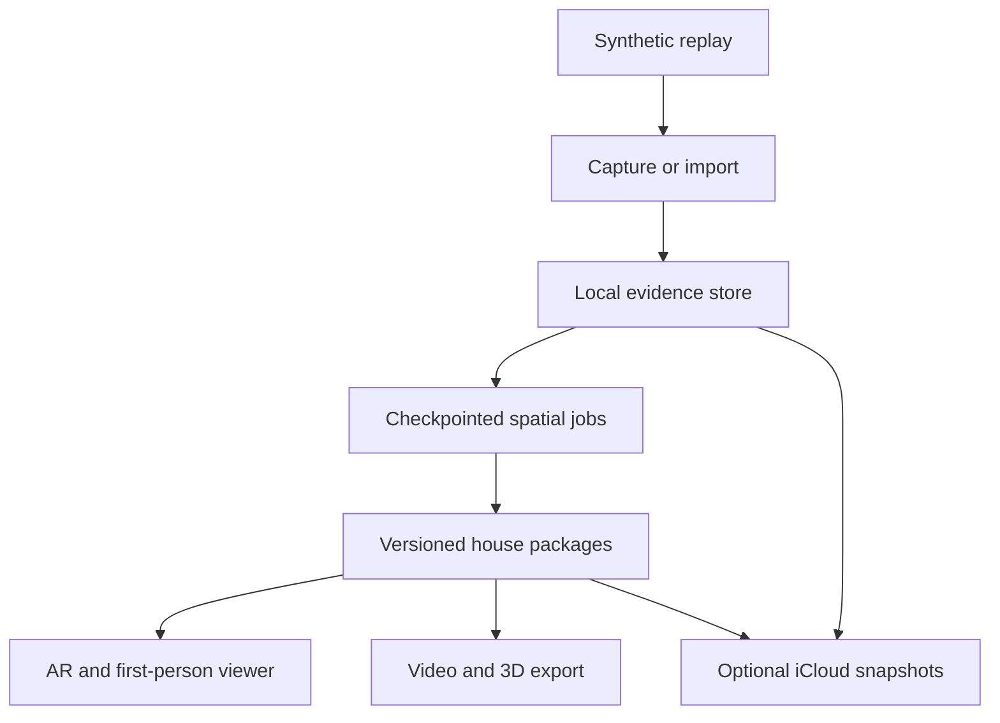

# House Memory — Personal App Architecture and Execution Runbook

Version: 2.1 · Revised October 18, 2026, America/New_York
Status: Execution runbook with the owner-requested homeowner guidance amendment R19. Current implementation and acceptance evidence are recorded in tasks/STATUS.md and docs/IMPLEMENTATION.md; requirements here are not claims that gates have passed.
Owner: Jared Verdi  
Working name: House Memory

## 0. Decisions and limits to read first

Build a **personal, local-first native iPhone app** that preserves construction photographs and spatial evidence, reconstructs the house, reveals previously captured services in live AR, supports game-like first-person exploration, and produces reusable 3D assets and automatic fly-through videos.

This revision replaces the previous hosted-service architecture. It is the complete current runbook, not an appendix that leaves the old backend requirements active.

### 0.1 What changed

| Previous plan | Current decision |
|---|---|
| Hosted API, PostgreSQL, S3, queues, GPU reconstruction workers | SQLite and immutable files on iPhone; bounded native reconstruction jobs |
| Cognito, accounts, memberships, invitations, tenant isolation | No application authentication, accounts, roles, billing, or subscription features |
| Operated cloud infrastructure and service monitoring | No application server, database service, domain, Vercel deployment, or server operations |
| Cloud originals and service backups | Local originals; optional incremental iCloud Drive snapshots; independent portable archive |
| Web review application | Native iPhone review, editing, measurements, and first-person viewer |
| Cloud labeling and IFC conversion | Local OCR/optional Core ML; on-device bounded IFC conversion |
| App Store release after TestFlight | Private internal TestFlight delivery with automated renewal; no public App Store submission |
| Generic 3D inspection | Touch/game-controller first-person navigation, stage/layer switching, collision, floor transitions |
| Export mainly for backup | Full archive, GLB, USD/USDZ, PLY/OBJ, semantic JSON/CSV, and automatic MP4 fly-throughs |
| Owner may use desktop release tools | ChatGPT Mobile is the development control surface; managed cloud machines do engineering/build work |

The app must continue to capture, process, label, navigate, measure, render videos, and export with networking disabled. Optional iCloud improves recovery and storage flexibility; it is not needed to run the app and does not perform reconstruction.

### 0.2 Fixed technology choices

| Area | Choice |
|---|---|
| Native application | Swift, SwiftUI, ARKit; iOS 26+ baseline, runtime capability checks |
| Capture hardware | Owner's actual LiDAR-capable iPhone; exact model/OS qualified before precision claims |
| Local store | SQLite through a pinned Swift wrapper, WAL transactions, immutable content-addressed files |
| Spatial engine | Portable C++ geometry/optimization core; OpenCV, Eigen, a trimmed Ceres build; Metal acceleration |
| Rendering | One Metal renderer for virtual walkthroughs, AR compositing, and deterministic offscreen video frames |
| Room shell | Observed ARKit geometry; optional RoomPlan assist, never the concealed-services model |
| Local recognition | Vision OCR and optional bundled Core ML models; manual annotation is always available |
| Backup | Optional app iCloud Drive document container with immutable chunked snapshots |
| Main interchange | glTF 2.0/GLB, USD/USDZ, PLY, OBJ; complete archive retains all evidence |
| Synthetic data | Procedural Blender/BlenderProc tooling on managed development workers |
| Development | Private Git repository plus ChatGPT/Codex cloud tasks controlled from iPhone |
| Native CI and delivery | GitHub-hosted macOS runners, scripted Xcode builds, App Store Connect APIs, internal TestFlight |
| Runtime external services | None required; optional Apple iCloud only |
| App Store publication | Excluded |
| Vercel | Not required and not provisioned |

iOS 26 is an intentional simplification for a personal app. Pin the actual stable SDK and supported owner-device profile during bootstrap; do not assume that every API or background resource is present merely because the OS version is sufficient.

### 0.3 Three boundaries that cannot be removed by architecture

**No routine manual engineering work is the target. Zero human interaction outside photography is not a supportable promise.** Apple enrollment, agreements/payment if required, account authorization/2FA, first TestFlight acceptance/install, system permissions, and occasional platform recovery can require the account holder. The agent prepares and performs every permitted engineering and administrative step; the owner completes only platform-controlled actions that cannot be delegated. Initial cloud-environment creation currently uses the web or desktop interface, while published environments can be used from mobile. An agent may perform web setup when supported; an iPhone browser handoff may still be required. No laptop is part of the default workflow. [S01] [S02]

**Internal TestFlight is renewable beta delivery, not a permanent installation entitlement.** Apple limits each build to 90 days. Automate new builds well before expiry and enable automatic updates, but do not promise that Apple will silently install every update or keep a personal beta available forever. App Store Connect is still required even though no public App Store release is planned. [S03] [S04]

**Local-only processing changes the engineering problem.** We cannot move the previous GPU reconstruction service to iCloud. Reconstruction, texture generation, recognition, and movie rendering must fit bounded on-device jobs. Foreground processing is the dependable path; background execution and GPU access are capability-dependent and interruptible. [S05]

### 0.4 Completion states

1. **Automated delivery proven:** a synthetic demo app reaches this iPhone from a ChatGPT-triggered source change without manual Xcode, archiving, or upload.
2. **Simulation-complete personal release candidate:** all native features, local processing, archives, exports, movie generation, and recovery pass their synthetic and CI gates.
3. **Owner-device qualified:** synthetic fixtures run through the actual phone's engine, renderer, encoder, storage, and interruption paths; real camera integration is checked.
4. **Field-validated personal release:** independent real captures establish the supported accuracy envelope and any necessary implementation repairs pass.
5. **Sustained personal use:** automatic beta refresh, reproducible builds, working backups, and standard-format exports keep the house record usable.

Simulation cannot establish real camera accuracy, iCloud reliability on the owner's account, or sustainable iPhone performance. Field work may expose defects beyond tuning. The failure branches and validation procedure are specified here rather than deferred.

### 0.5 Review map

| Topic | Sections |
|---|---|
| Requirements and accuracy | 1–2 |
| Local architecture and phone-controlled delivery | 3–5 |
| Frames, references, data, and capture | 6–9 |
| On-device reconstruction and AR | 10–11 |
| First-person navigation, layers, films, and exports | 12–15 |
| Labels, drawings, and iCloud | 16–18 |
| Device execution, simulation, and evaluation | 19–22 |
| Operations, work packages, field protocol | 23–27 |
| Risks, traceability, review, sources | 28–31 |

## 1. Product requirements and scope

### 1.1 Required journeys

| ID | Requirement | Completion evidence |
|---|---|---|
| R01 | Organize a house into levels, rooms, boundaries, wall sides, and ceilings | Stable identities remain distinct across sessions and stages |
| R02 | Connect architectural drawings and BIM | Calibrated PDF/image and bounded IFC imports align without replacing observed geometry |
| R03 | Preserve coordinates through construction | Durable reference network and independent stage-registration checks |
| R04 | Capture exposed construction offline | Images, depth, poses, notes, and quality evidence survive interruptions |
| R05 | Know where capture is incomplete | Visibility-aware coverage distinguishes missing, blocked, poor-quality, and adequately observed areas |
| R06 | Reconstruct locally | The iPhone produces versioned geometry, textures, maps, and quality reports without a service |
| R07 | Explore in first person | Touch navigation, optional controller, collision, floors, bookmarks, and offline detail streaming |
| R08 | Switch construction and service layers | Finished/unfinished walls and ceilings, stage comparison, and selected systems remain spatially registered |
| R09 | Identify HVAC, electric, low voltage, plumbing, and structure | Editable evidence-linked objects, routes, endpoints, and searchable attributes |
| R10 | Point at finished surfaces | Local marker/visual localization reveals correctly selected historical evidence with accuracy status |
| R11 | Measure the house | Named surfaces, units, dates, uncertainty, and source geometry accompany dimensions |
| R12 | Generate automatic fly-throughs | Automatic route, camera direction, layer reveals, encoding, and shareable MP4 |
| R13 | Export for other projects | Validated GLB, USD/USDZ, PLY/OBJ, metadata, and complete archival export |
| R14 | Recover without a backend | Offline operation, optional iCloud snapshots, local restore, and independent archive recovery |
| R15 | Develop from ChatGPT Mobile | Agents change code, run tests, inspect artifacts, repair failures, and deliver signed builds |
| R16 | Avoid commercial product overhead | No app login, billing, backend, hosted reconstruction, public release, or recurring server management |
| R17 | Iterate without physical capture dependencies | Procedural houses and observation replay test the real portable core and native UI |
| R18 | Remain trustworthy on the owner's phone | Capability, performance, field accuracy, migration, and beta-expiry gates pass |
| R19 | Learn and use the app without technical expertise | Restartable first-use guidance and searchable offline homeowner task guides pass §1.4 |

### 1.2 Supported envelope

The initial house envelope is up to four levels and 100 named spaces. The archive format can represent 50,000 images and 500 GB of evidence, but **this is an archive capacity target, not a requirement to keep 500 GB on the phone or process it together**. The active working set is one room or wall segment. Every allocation and admission decision considers actual free disk and measured memory pressure.

Capture segments normally last 2–5 minutes, with 100–300 retained spatial keyframes per processing partition as the initial workload. Detail stills are additional documentary observations. Large rooms divide into overlapping submaps. The exact admitted partition size is calibrated by on-device benchmarks.

One active editing device per house is the v1 model. Another device can restore a snapshot or open exports; seamless simultaneous multi-device editing is excluded. This removes a synchronization service and conflict-merging project while retaining a recoverable personal archive.

Non-LiDAR devices may view/import/export and annotate. Precision capture requires the qualified LiDAR workflow. The owner-device is the release target; supporting another phone is optional and requires qualification, not a launch prerequisite.

### 1.3 Scope boundaries

The app displays historically captured construction; it does not sense through drywall. It does not infer a safe drilling location, electrical continuity, pipe contents, code compliance, or unseen connection. It keeps photographic evidence separate from inferred geometry.

No Android client, multiplayer walkthrough, public website, contractor accounts, billing, custom authentication, cloud AI API, remote GPU service, or self-hosted development machine is included. A free Vercel instance is not needed. Native proprietary RVT/DWG editing is excluded; PDF/IFC exports are accepted.

Finished appearance is an **observed finished capture** only when captured after finishing. Before then, an optional finish shell can be generated from measured/design assemblies and shown as a clearly labeled planned visualization. Its textures and unseen details are not evidence of the eventual house.

An owner can review or correct uncertain labels and alignments. Agents automate engineering; they cannot determine unknown physical cable identity or access an occluded surface through software. The UI must accommodate uncertainty rather than demand complete manual labeling before the record is useful.

### 1.4 Homeowner onboarding and in-app guidance — added October 18, 2026

**R19.** First-time use must explain how to achieve a useful construction record without technical training. Homeowners must be able to choose a starting goal: record exposed work before walls close, document a later visit, or find earlier records. The introduction must explain one-room setup, dated construction stages, capture/import, review before closure, finding records and independent backup. It must be skippable, remember completion across launches, and appear for existing installations that have not seen it.

Help settings must provide **Restart introduction** and a persistent **Show introduction next time** switch, plus a changeable starting goal. Replaying or skipping guidance must not change houses, originals, notes, selection history or backups. No account, network access or camera permission is needed to read guidance.

Human-readable guides must be bundled offline, searchable by tasks and common words, reachable before creating a house and from House, Capture, Evidence, Explore and Tools. Each guide must state the intended result, use actual control names, give concrete steps and offer a relevant next action. Coverage includes setup, pre-cover capture, dated changes, ordinary photo import/annotation, optional printed references and stage alignment, closure review, finding evidence, navigation/layers, live reveal prerequisites, backups/restores, sharing, drawing references, troubleshooting and a plain-language glossary. Explanations must distinguish observed, planned, synthetic and approximate records without requiring implementation knowledge. Missing views and unavailable overlays must lead to useful photo-based alternatives, with no claim that the app sees through drywall or certifies unseen cavities.

Acceptance requires Debug and Release compilation, first-use completion and skip/relaunch persistence, restart and next-launch replay, preserved house records/preferences, guide search and empty-search recovery, correct task navigation, help before project creation, and reachable content in landscape and large text. Inspect retained native UI screenshots and keep prior failures. VoiceOver labels, scalable text and scrollable layouts are required; actual owner-device accessibility/usability and construction-site comprehension remain part of device acceptance. Guidance completion never implies spatial or physical qualification. This requirement is added to P0/P1 product usability and the end-to-end acceptance demonstration; it does not remove other runbook gates.

## 2. Accuracy and evidence contract

### 2.1 Separate the errors

Track acquisition, reconstruction, reference measurement, inter-session registration, stage registration, feature annotation, live localization, projection, and timing separately. ARKit depth-confidence categories are sensor signals, not millimeter error bounds. [S06]

Use propagated covariance where justified and empirical error floors from independent tests. Correlated depth bias, pose drift, repeated-frame smoothing, and common controls cannot be treated as independent observations simply to shrink uncertainty. Class confidence, geometric uncertainty, identity confidence, connection verification, stage freshness, and current alignment quality are different fields.

### 2.2 Evidence tiers

| Tier | Meaning | Allowed behavior |
|---|---|---|
| Documentary | Correct source association; placement may be unknown | Photographs, notes, dates, and 2D labels |
| Spatial approximate | Geometry exists without a validated precision envelope | Qualified 3D/AR placement and planning dimensions |
| Locally validated | Device/profile, region, references, and current localization meet validation conditions | Positioning with an empirical uncertainty range |
| Independently measured | Selected geometry/dimensions checked with an external method | Preserve the independent evidence; live AR still has separate uncertainty |

A precise room does not qualify the whole house. Stage selection, reference validity, viewing distance, motion, and time since revalidation determine current eligibility. Missing calibration means approximate, not zero error.

### 2.3 Targets

For independently checked features in a bounded local wall/ceiling region, target p95 3D placement error at or below 10 mm and no accepted validation sample above 25 mm, initially at 0.5–3 m viewing distance. Report both full 3D and wall-plane errors. Ground-truth measurement uncertainty should be at most 2 mm for this test.

For ordinary room dimensions, target p95 error at or below the larger of 20 mm and 0.5% of distance. Name the reference surfaces: framing versus drywall, subfloor versus finished floor, pipe centerline versus outside envelope.

These are proposed engineering gates, not known consumer LiDAR capabilities. Local-only execution does not loosen them. If the system cannot pass, improve acquisition/reference constraints or report the measured limitation; do not silently redefine success.

### 2.4 Error budget and rejection

The diagnostic allocation is 2 mm control uncertainty, 4 mm reconstructed feature position, 3 mm stage registration, 3 mm live translation, 4 mm rotational displacement at the feature, and 2 mm projection/timing. Their sum is 18 mm; the approximately 7.6 mm root-sum-square is meaningful only under independence and compatible statistical definitions. End-to-end empirical tests remain authoritative.

At 3 m, 0.1 degree of orientation error displaces a point about 5.2 mm. A small marker with a good fit residual therefore cannot qualify an entire room. Evaluate conditioning, distance from controls, repeated reference agreement, bias, and motion.

On tracking loss, wrong-room ambiguity, moved references, invalidated calibration, or excessive residuals, withdraw precise overlays immediately. Do not freeze a precise-looking overlay while the camera moves. Keep photos and approximate navigation available.

## 3. Local architecture and component contracts

### 3.1 Runtime data flow



Everything except optional snapshot replication runs in the installed app. Development workers generate test input and compile binaries; the shipping app never sends a house to those workers to make a feature function.

### 3.2 Module ownership

| Module | Responsibilities | Boundary |
|---|---|---|
| AppShell | SwiftUI screens, settings, permissions, progress | No geometry math embedded in view code |
| CaptureAdapter | ARFrame extraction, high-resolution observations, tracking events | Produces versioned ObservationStream |
| ReplayAdapter | Synthetic/recorded observations and fault injection | Same consumer contract, no oracle access |
| HouseStore | SQLite, immutable assets, transactions, recovery, indexes | Only writer of authoritative metadata |
| JobEngine | Dependencies, checkpoints, cancellation, resource scheduling | Local durable queue, no HTTP worker API |
| SpatialCore | Frames, feature tracks, factors, triangulation, sparse fusion | Portable C++ with CPU reference implementation |
| MetalCompute | Bounded accelerated fusion/image operations | Same observable contracts as CPU reference |
| Localization | Marker detection, finished-map retrieval, PnP, verification | Returns pose hypotheses plus reasoned eligibility |
| SceneCompiler | Stage/layer packages, LOD, textures, picking and provenance | Never changes metric truth to improve appearance |
| HouseRenderer | Virtual camera, AR compositing, offscreen frames, clipping | One scene and material contract |
| Navigation | Walk/free-fly, collision, portals, floor changes | Operates on navigation proxy distinct from evidence mesh |
| TourDirector | Automatic routes, shots, timing, layer events | Deterministic plan, no external model call |
| ExportEngine | Movie encoding, standard-format writers, complete archive | Streams outputs and validates before publishing |
| DrawingImport | PDFKit, image calibration, bounded IFC/WASM adapter | Preserves original source and units |
| AppleBackupAdapter | iCloud document coordination and restore discovery | Optional, replaceable by local Files archive |
| Diagnostics | Local logs, self-tests, replay packages | No automatic external telemetry service |

Use Swift concurrency for orchestration and actor isolation around store/job state. Cross the C++ boundary through a narrow, versioned C ABI or verified Swift/C++ interface. Do not pass live ARFrame ownership into long-running C++ tasks.

### 3.3 Rendering choice

Use Metal rather than relying on a game engine or a scene-view snapshot loop. The common renderer accepts ScenePackage, CameraState, LayerSelection, RenderOptions, and an output target. Interactive mode renders to a drawable; video mode renders to a pixel-buffer-backed texture at an exact timestamp; AR mode composites the live calibrated camera feed with historical geometry.

Implement a modest material set: textured opaque surfaces, alpha-masked surfaces, transparent reveal surfaces, unlit evidence colors, lines/tubes, labels, and uncertainty styles. Avoid a general cinematic engine, baked global illumination dependency, and runtime shader authoring UI. Static captured textures provide appearance; dynamic headlight/ambient modes improve inspection.

A native renderer increases initial implementation work but removes divergent video and walkthrough render paths. Numerical reference images, tiny golden scenes, and shader tests address the resulting risk in P0/P2, before detailed reconstruction work.

### 3.4 Persistent boundaries

Originals, metric observations, semantic routes, display meshes, navigation proxies, and movie exports are separate artifacts. A lower-detail viewer or altered collision mesh must not change a measurement. Unknown geometry is never filled merely because the navigation or tour planner wants a closed surface.

## 4. Development controlled from ChatGPT Mobile

### 4.1 Normal iteration

1. Owner describes a feature or defect in ChatGPT Mobile.
2. Agent opens the persistent repository and task ledger in a managed cloud environment.
3. Agent implements code, generates/reuses synthetic data, runs targeted portable tests, and pushes a reviewable branch.
4. Managed CI builds Swift/C++/Metal, runs supported simulator and platform tests, and publishes screenshots, test logs, and synthetic tour movies.
5. Agent reads failures, repairs them within the task budget, and checks the required gates.
6. Authorized release automation integrates the passing change and builds a signed archive.
7. Upload automation waits for Apple processing and assigns the build to the owner's internal TestFlight group.
8. Owner receives the build on iPhone; automatic updates are enabled where available.
9. App can run a bundled synthetic self-test to measure the actual phone without new physical captures.
10. Feedback goes back to the same ChatGPT task with build ID and an optional diagnostic attachment.

“Uploaded” is not “available in TestFlight,” and “available” is not “installed.” Track these separately. The agent reports actual observed states and never claims it has remotely inspected the owner's installation without evidence.

### 4.2 Bootstrap is a deliverable, not homework

Before implementing the difficult spatial features, prove this loop with a minimal app that loads a synthetic room, renders one frame, writes a local record, exports a short movie, and reaches the phone through internal TestFlight.

The agent generates the Xcode project, schemes, entitlements, assets, dependency lockfiles, build scripts, export options, CI workflows, API scripts, and release records. Use a generated project configuration with a pinned generator, or a deterministic checked-in Xcode project; the owner never edits Xcode settings.

The owner may need to authorize repository access and Apple's account-controlled steps. Prefer supported connectors/APIs; use permitted browser automation where necessary. If a UI requires the owner's secure action, present the exact ready-to-complete screen/action, not a list of manual engineering instructions.

**Hard gate:** do not claim the phone-only delivery requirement is satisfied until a build has actually completed this loop. Current chat tools and account permissions are not assumed to include repository creation, CI secret installation, workflow dispatch, or Apple administration. Test each capability and preserve results.

### 4.3 Automation boundary

| Work | Intended owner | Unavoidable qualification |
|---|---|---|
| Code, project files, tests, fixtures, screenshots, release notes | Agent | Must have repository and runner access |
| Archive, signing, upload, processing polling, beta-group assignment | CI and agent | Apple credentials/capabilities must be authorized first |
| Repair build/test failures | Agent | Bounded retries; no weakening acceptance criteria |
| Build refresh and expiry checks | Scheduled CI | Provider outages, quota, expired membership, and agreement changes can interrupt it |
| Apple enrollment, payment, legal acceptance, 2FA | Account holder when required | Cannot be promised fully autonomous |
| Initial TestFlight acceptance/install and OS permissions | iPhone owner when required | Agents cannot bypass system consent |
| On-device synthetic regression suite | App automatically after authorized start/update policy | Opening app or resuming foreground work can still be necessary |
| Sending local diagnostics into ChatGPT | System share action or verified supported integration | No assumed agent access to the app sandbox or private iCloud |
| Physical captures and reference placement/checks | Owner or helper | Necessary physical inputs, not software work |

A personal local app cannot silently make its sandbox available to ChatGPT. Provide a one-action “Share diagnostics” flow and an App Intent that prepares the same package. If ChatGPT integration cannot receive it automatically, a share/attachment action remains. Do not add a hidden server, embed a GitHub write token in the app, or give agents the owner's Apple password to erase this boundary.

Use Apple's existing TestFlight crash/feedback facilities wherever they supply the needed evidence. The agent can retrieve available beta crash submissions through authorized App Store Connect APIs and correlate them with retained symbols/build IDs. This reduces manual log collection, but does not expose arbitrary local self-test reports or sensor replays. A custom diagnostic attachment remains the fallback for those records. [S29]

### 4.4 Durable agent state

The repository contains this runbook, a machine-readable task graph, architecture decisions, contracts, test fixtures, release history, and the current next action. Every substantial task commits a resumable checkpoint. Temporary cloud workspaces and conversation memory are not source control.

CI reports and release summaries are readable through authorized tools from mobile. The agent should supply a short status with build/commit, observed failures, repair outcome, and install availability. Human intervention is reserved for missing account authority, physical evidence, changed budget/scope, or a platform action that cannot be automated.

There is no continuously running self-hosted agent service. ChatGPT/Codex cloud tasks and managed CI provide execution when invoked or scheduled within their supported capabilities. Do not promise that an idle chat will spontaneously repair a future outage without an authorized automation.

## 5. Signing, private distribution, and renewal

### 5.1 Primary path

Use a private Git repository and GitHub-hosted macOS runners. Managed macOS CI avoids requiring a personal Mac or maintaining a rented machine. Runner availability, installed Xcode, simulator behavior, Metal capability, and included build minutes must be checked at bootstrap. They are not presumed free or equivalent to a real iPhone. [S07]

Select a stable managed runner image available to the account and pin its Xcode/tool versions in the release manifest. Do not let an unreviewed moving latest label change the compiler/SDK under an automatic renewal. Runner-image retirement triggers the compatibility job before the next release. Included private-repository minutes/storage depend on the account plan. [S25]

Use App Store Connect API credentials for supported app-management, certificate/profile, build, and beta operations. Generate/store signing material in the CI secret facility or use supported automatic signing with an authenticated build workflow. Use ephemeral keychains and delete temporary key material at job completion. Pin the release script/tool version and inspect the signed archive's entitlements. [S08]

Create the private app record and internal tester group, add the owner, and configure automatic distribution. “No App Store release” means no public listing/release review workflow; it does not eliminate the App Store Connect record or Apple Developer Program prerequisites. Internal testing avoids the external-testers review path for this design. [S03] [S04]

Verify actual group membership after every upload rather than trusting the automatic-distribution checkbox. If a build needs explicit group assignment, perform it through the supported beta-management API. In particular, Xcode Cloud's documented group-assignment behavior differs from ordinary uploaded builds; any alternative build provider must pass the same delivery test. [S03]

Xcode Cloud remains an optional managed build replacement, but is not the default: Apple's documented initial setup starts in Xcode. Do not hide a mandatory local-Xcode setup step in a purported phone-only path. A change to Xcode Cloud must first demonstrate fully delegated setup on an available managed Mac. [S09]

### 5.2 Release transaction

Compile and test the exact commit; archive; verify bundle ID/team/entitlements; retain symbols; sign/export; upload through a supported Apple tool/API; poll processing with a bounded timeout; complete applicable beta metadata/export-compliance declarations truthfully; assign to the internal group; record availability and expiration.

Build numbers are monotonic and derived from the release ledger, not a race-prone local counter. Serialize release jobs. Retry an upload idempotently by querying existing build/version state first. Failed processing keeps the previous build available and creates an actionable failure record.

Apple may require account-holder declarations or updated agreements. Automation must detect those states and explain the exact block. The agent must not falsely assert regulatory answers or accept agreements as the owner without authorization.

### 5.3 Expiry and longevity

Check active build expiry daily in managed CI. At 45 days since the current known-good upload, create a fresh build from the compatible known-good source, with a new build number and the standard qualification suite. Warn at 30, 14, and 7 days remaining if no replacement is available. These intervals are design choices within Apple's 90-day testing window. [S03]

Enable TestFlight automatic updates, but maintain an explicit install link because updates are not guaranteed immediate. Local app notifications and CI/provider notices can surface expiry without an application backend. A scheduled workflow is not assumed infallible; rerun the preflight on each mobile development session.

If a beta expires, its app data is not treated as a reliable accessible archive. Original files and snapshots must already be recoverable independently. Rebuild/re-sign rather than delete/reinstall blindly. A shared movie or GLB remains usable independently of TestFlight.

Ad hoc distribution is a contingency only if TestFlight becomes unsuitable: it adds registered-device/provisioning renewal and a secure installation channel, often increasing owner interaction. Free provisioning is not the selected route because recurring signing/install restrictions conflict with this workflow. Neither route promises indefinite unattended installation. Do not publish the app publicly as an automatic fallback.

### 5.4 Costs and access

No recurring application-server bill is required. Apple developer membership, iCloud capacity, ChatGPT usage, private-repository CI minutes/storage, and synthetic rendering compute can still have costs. Check current account allowances before enabling paid jobs. No prices, account access, or paid resources are assumed by this plan.

The owner need not manage servers. Managed CI configuration and Apple account ownership are still real dependencies. If paid macOS minutes are disallowed and included capacity is insufficient, pace builds or report the delivery blocker; do not invent a free unlimited runner.

## 6. Coordinates, timing, and sensor contracts

### 6.1 Frames and units

Canonical frame H is right-handed, meters, +Z up, +X along a documented building axis, and +Y completing the basis. It is not GPS or magnetic north. Maintain explicit frames for level L, capture segment S, CV camera C, marker board M, wall side W, drawing D, and each imported model.

The CV camera has +X image-right, +Y image-down, +Z forward. Define every transform as T_target_from_source acting on homogeneous column vectors. Serialize 16 values in row-major order; storage order does not change the mathematical convention. Quaternions are [x,y,z,w], normalized, with source/destination names.

ARKit camera coordinates convert to CV with diag(1,-1,-1,1), with image/display orientation handled separately. Thus T_S_from_Ccv = T_S_from_Carkit × diag(1,-1,-1,1). Verify against the SDK and asymmetric fixtures. [S10]

Wall coordinates use +U along the wall, +V up, and +N toward the named observing room, with U cross V = N. A wall has two distinct sides and a volume. A ceiling has its own oriented boundary frame, adjacent spaces, and assembly depth; do not overload “up” to infer which surface is selected.

### 6.2 Composition and precision

For a house point, p_C = inverse(T_H_from_C) × p_H, and T_H_from_C = T_H_from_S × T_S_from_C. For a known marker, T_H_from_C = T_H_from_M × inverse(T_C_from_M).

Transforms carry source/destination IDs, revision, validity, provenance, and uncertainty. Reject singular/nonfinite matrices, wrong-handed bases, and scale in a rigid edge. Photo-only initialization may estimate a similarity transform explicitly; metric scale cannot later drift silently.

Use float64 for canonical transforms, optimization, and measurement. Render with float32 and room-local origin rebasing. IFC georeferencing and large model coordinates remain recorded even when a local display origin is used. glTF Y-up conversion and USD upAxis/metersPerUnit are explicit tested adapters.

### 6.3 Camera and depth

Store intrinsics for the actual encoded image, original resolution, crop/resize mapping, image orientation, lens/mode, distortion model, and image-to-display transform. Pixel centers are integer coordinates in the canonical convention. Test half-pixel conversions and portrait/landscape/aspect-fill paths.

Canonical depth is optical-axis Z in meters, with explicit invalid mask. Distinguish radial distance from Z depth; BlenderProc can output both. Preserve native depth/confidence arrays and conversion metadata. [S11]

Rear-LiDAR capture uses supported ARKit sceneDepth, preserving raw versus smoothed depth identity. Do not substitute another depth API merely because its name sounds similar. Smoothed depth samples have temporal correlation. Missing depth produces rgb_posed or image_unregistered observations, never fabricated zeros or an identity pose. [S06]

ARKit owns the camera. Request high-resolution observations through supported ARKit capture APIs and validate the returned calibration/pose. A detail image with uncertain pose remains documentary until independently registered. Do not attach the nearest video-frame pose by timestamp alone. [S12]

### 6.4 Clocks and segment continuity

Use monotonic timestamps and a separately recorded mapping to UTC. Preserve separate camera/depth/motion clocks when exposed. Unknown synchronization remains explicit. Record tracking interruptions, lens/mode changes, dropped buffers, and thermal events.

Each tracking restart creates a new segment unless continuity is verified. No claim is made to access Apple's internal IMU fusion or covariance. Synthetic replay provides a noisy pose prior using the same field as the native adapter; it does not supply perfect truth to the application.

### 6.5 Mandatory analytic fixtures

Before reconstruction, pass asymmetric axes, slanted plane, foreground wire/background wall, all phone orientations, crop/resize, distorted lens, known marker, mirrored image, millimeter/inch/meter import, far-origin IFC, independently initialized sessions, opposite wall sides, and ceiling/floor conversion fixtures.

Test projection/unprojection, composition/inverse, timestamp selection, scale preservation, and file round trips. A visually plausible house is not evidence that these contracts are correct.

## 7. References and construction-stage continuity

### 7.1 Practical reference method

Use known-geometry AprilTag boards for the first precision localization path. A QR/NFC identifier may name a room but is not by itself a metric six-degree-of-freedom pose reference. Board size, flatness, actual printed dimensions, corner ordering, placement, and visibility affect accuracy. [S13]

Establish redundant references per floor and precision region. Prefer well-separated observations and independent checks rather than trusting one tiny near-frontal tag. IDs are unique within the house; detect duplicate or moved boards. The app generates printable boards, installation diagrams, measurement forms, and an inventory automatically.

Installing/checking physical references is part of the physical capture workflow. Software cannot perform it. If the owner declines references, retain automatic/documentary capture but do not promise the same local accuracy.

### 7.2 Surviving finishing

For each reference record substrate, measured pose, uncertainty, photos, access, expected survival, and replacement procedure. Use permanent accessible structure or a repeatable fixture whose remount error is measured. An outlet cover, trim edge, or drywall face is not automatically stable.

If references must move, capture and measure old and new sets while both are accessible. Keep redundant checkpoints and the handoff transform. A photo of a marker before it is buried cannot recover its finished-stage pose.

Reference geometry is distinct from architectural plans. Design dimensions can guide placement but do not survey the installed board. A professional control/scan import may strengthen the network; the baseline does not require commissioning a survey to begin development.

### 7.3 Stages and real changes

Model framing, service rough-in, insulation, drywall, finished surfaces, furnishings, and later renovation as dated observations. Geometry can move or disappear between stages. Register through unchanged controls/features, not changed wall faces.

Preserve measured or declared finish offsets, including drywall, tile, furring, flooring, and lowered ceilings/acoustic assemblies. A finished surface moved inward does not move the historical cable.

Capture a finished visual map for convenient relocalization. Keep the surviving references as recovery when blank walls, furniture changes, or nearly identical rooms defeat appearance matching.

### 7.4 Reference validation

Reserve independent points not used in fitting. Examine residual direction, local scale, and conditioning. A low fitting residual alone is insufficient. Disagreement quarantines a transform and all dependent precision claims.

Local profile validity is stored in the house; no remote signed eligibility service is needed. A new app/profile version or changed control invalidates affected artifacts. Offline use relies on known local state and current observations; it cannot detect an unreported physical change elsewhere.

## 8. Local data model, packages, and revisions

### 8.1 Entities

| Entity | Essential fields |
|---|---|
| House / level / space | UUIDs, names, frames, level membership |
| Boundary / wall side / ceiling | Adjacent spaces, orientation, thickness/volume, revision |
| Stage | Date, predecessor, observed/planned status, spatial validity masks |
| Session / segment | Device, OS, profile, stage, timestamps, tracking state |
| Observation | Original and normalized assets, camera, pose prior, quality, evidence |
| Reference / transform | Geometry, installation, validity, covariance policy, revision |
| Reconstruction | Exact input hashes, solver/config versions, checkpoints, quality |
| Feature / route / endpoint | Stable ID, class, geometry, uncertainty, continuity evidence |
| Annotation | 2D/3D anchors, source observations, revision, reviewed status |
| Drawing / BIM source | Original file, units, page/GUID, transform, source revision |
| Measurement | Selected points/surfaces, method, value, uncertainty, provenance |
| Coverage | Region, side/depth interval, visibility, quality, missing reason |
| Scene / navigation package | LODs, materials, semantic layers, navigation proxy, version |
| Tour | Camera path, shots, layer events, duration, source-package hash |
| Job / artifact | State, resource estimate, dependencies, checksums, errors |
| Snapshot | Parent/version, asset manifest, transfer state, verification state |
| Calibration | Model/OS/lens/mode, parameters, validation evidence, eligibility |

There is no tenant, account, membership, payment, API-token, or authorization table. Device identity is only an origin/conflict marker for snapshots, not a login.

### 8.2 Files and atomic writes

The app's Application Support directory contains house metadata, immutable originals, normalized observations, derived packages, and the durable job ledger. Reconstructible previews live in caches. Originals are not placed in a purgeable cache. Files destinations and optional iCloud snapshots are independent outputs.

Write bytes to a temporary file, flush, atomically rename, then commit the database reference. On launch, reconcile orphan temporaries and incomplete rows. Hash every immutable asset with SHA-256. A file path never establishes identity by itself.

Separate capture commits from job publication. A completed file or half-built mesh cannot become the current model until its manifest, references, hashes, and quality state are committed in one publication transaction.

### 8.3 Observation bundle

The portable bundle is versioned JSON/JSONL plus images and lossless native arrays. Example values are illustrative, not actual captures.

```json
{
  "schema_version": "2.0",
  "bundle_id": "example-session",
  "source_kind": "synthetic",
  "house_id": "example-house",
  "stage_id": "rough-in",
  "session_frame_id": "segment-a",
  "units": {"length": "m", "angle": "rad"},
  "camera_convention": "cv_x_right_y_down_z_forward",
  "matrix_serialization": "row_major_column_vector_math",
  "frames_index": "frames.jsonl",
  "assets_manifest": "assets.json",
  "profile_id": "simulation-v1"
}
```

Each observation declares rgbd_posed, rgb_posed, or image_unregistered. Include image size/hash, K, distortion/crop, T_S_from_C_estimate when available, timestamp/clock mapping, depth shape/encoding/endian/invalid-mask, confidence encoding, tracking state, and exposed capture metadata. Null means unavailable, with a reason; it never means identity.

Asset paths are relative and normalized. Reject traversal, symlink escape, remote-resource fetches, decompression bombs, nonfinite geometry, invalid indices, and excessive declared allocation. This is file robustness for a personal app, not a commercial compliance program.

### 8.4 Scene package

A scene package contains canonical mesh/point data, display LODs, texture atlas pages, stable feature/source mappings, stage/layer membership, wall volumes, coverage/uncertainty masks, room portals, navigation proxies, localization maps, and revision hashes.

Display vertices and GPU picking IDs are not persistent object identifiers. Measurements refer to the higher-fidelity geometry and observed points. The same package feeds interactive display, AR, movie export, and standard-format conversion.

### 8.5 Change propagation

Original observations and published package bytes are immutable. The current view points to an approved revision. Edits append annotation/feature revisions. Reprocessing projects evidence anchors through validated transforms and presents conflicts instead of silently moving verified routes.

Maintain a dependency graph: control/calibration/observation → transform/reconstruction → measurements/localization/scene/tour/export. A changed reference or corrected sensor adapter invalidates affected precision results and marks old tours/exports stale. An exported file cannot be recalled, but its embedded manifest identifies the source revision.

Keep deletion tombstones and a local undo/recovery policy. Deleting source evidence warns about dependent measurements. Distinguish removing a local downloaded copy from deleting the underlying house record or snapshots.

### 8.6 Schema migration

Before migration, create and verify a recoverable local metadata snapshot. Use additive changes and explicit format versions; retain a current/previous-version read path where practical. Large asset migrations run as checkpointed jobs without duplicating the whole archive unnecessarily.

An older build must not write into a newer incompatible schema. It offers read/export if supported, otherwise an update/restore explanation. Test TestFlight update, rollback/rebuild, and interrupted migration. Never suggest uninstalling as the first recovery action.

## 9. Capture quality and completeness

### 9.1 Session state machine

Prepared → anchored → capturing → paused/interrupted → locally finalized → processing → review required → approved.

Backup state is independent: local only → staged for iCloud → uploading → system-reported uploaded → restore verified. Geometry approval does not imply backup, and backup does not imply accurate reconstruction.

### 9.2 Preflight

Select house/floor/room/stage and wall side or ceiling. Check camera/LiDAR support, permissions, free disk, battery, thermal state, lens mode, and reference availability. Load all local reference data before capture. No sign-in screen or network gate exists.

Record obstruction/inaccessible regions and changes since the last visit. When a precision reference is unavailable, allow documentary capture explicitly. No construction record should be lost because a precision precondition failed.

### 9.3 Acquisition

Use ARKit as the main camera owner. Copy needed buffers promptly and encode off the capture callback. Keep bounded producer/consumer queues; discard optional keyframes before blocking tracking.

Start keyframe selection near 0.10–0.25 m translation or 5–10 degrees rotation, adjusted by overlap, image quality, and reconstruction need. Retain lower-rate tracking telemetry. Pure rotation does not supply useful triangulation baseline.

Capture detail stills of labels, bends, junctions, plates, backing, penetrations, and endpoints. A close detail image supports identification even if its depth is unreliable. Lens/resolution changes start a new calibration group.

If tracking is limited, preserve useful documentary images but do not count them as valid metric coverage. Save originals before denoising, contrast adjustment, or texture blending.

### 9.4 Coverage

Define expected surfaces/volumes from confirmed room boundaries, drawings, rough geometry, and cavity structure. Use an initial 100 mm wall/ceiling grid, refining around small objects, penetrations, corners, and endpoints.

Maintain independent visibility, photographic sampling, triangulation support, depth reliability, semantic review, and stage freshness. Ray-test against the first visible surface; seeing a stud face does not cover the cavity behind it. Track both wall sides and depth intervals.

Request roughly 70–80% overlap and at least three useful views for important geometry where feasible. Quality uses blur, saturation/shadow, image sampling, view angle, translation, and sensor status. Thresholds are device/profile-dependent, not a universal lux number.

For small features such as a 3 mm cable, target several usable pixels across its width; approximately 0.5 mm/pixel is an initial close-detail goal, not a geometric guarantee. A wire captured as one blurred pixel cannot be reconstructed accurately by later software.

### 9.5 Guidance and review

Show captured, needs another view, poor quality, blocked, and not visited. Provide one prompt at a time: slow down, move sideways, illuminate cavity, move closer, revisit reference. Combine text, shapes, haptics, and optional voice.

Highlight missing regions in the wall/ceiling view and floor index. Closure review lists dates, unresolved gaps, and changes since capture. An acknowledged obstruction remains blocked, never green complete.

Do not require constant screen attention while moving around unfinished construction. Guidance operates in short stationary viewpoints and short sweeps. The user controls capture; the app does not direct unsafe physical access.

### 9.6 Milestones and storage

Capture framing/blocking; completed services before insulation; late changes; accessible insulation/fire-stopping; finished surfaces; and later alterations. Include joist cavities, chases, access panels, and safely accessible under-floor/under-slab work while visible.

Estimate remaining capacity before recording. Keep a reserve sufficient to finalize the current session and recover metadata. At the threshold, pause and explain; do not silently lower photo quality. Stop optional reconstruction during capture and respond to thermal pressure before the OS terminates the app.

### 9.7 Preserve the house before the app is finished

The real construction visibility window is independent of software delivery. If closure arrives first, use organized original photos plus room/wall/stage identifiers, measured references, and verified exports from an interim recorder. Retain any available sensor data without assuming ordinary photos contain poses/depth.

This is evidence preservation, not a request for repeated physical development data. The import workflow must accept imperfect historical records as documentary or approximate evidence. Missing pre-closure views cannot be regenerated later.

## 10. On-device reconstruction

### 10.1 This is a native bounded pipeline

Do not ship Python, COLMAP command-line jobs, Blender, or Open3D's desktop pipeline as a hidden phone runtime requirement. Those tools can provide development comparisons. The production path is a portable native core plus Metal kernels built into the app.

Pipeline: validate → normalize → partition/select → detect references → match/track → initialize → optimize → fuse → texture → trace/review features → assess → compile candidate → publish.

Each stage records input hashes, configuration, resource estimates, checkpoint format, cancellation boundary, and terminal versus retryable errors.

### 10.2 Pose and feature optimization

Use captured ARKit poses as noisy priors. Extract a bounded canonical feature set through OpenCV; start with SIFT for the reference/localization baseline, and benchmark capture-time cost separately. Use temporal overlap and room adjacency to restrict matching without trusting labels as proof.

Detect marker corners, geometrically verify tracks, and solve image reprojection, reference constraints, selected depth, and relative pose-prior factors with robust losses. A trimmed Ceres/Eigen build provides optimization; cross-compilation and binary size are P0 gates. Numerical Jacobian checks and analytic fixtures test each factor.

Optimize 100–300-keyframe partitions with local windows and bounded landmark counts. Use a hierarchical graph for room/floor alignment rather than global bundle adjustment over every photograph. Loop closures require geometric verification; repeated stud bays cannot force a merge.

Fix the metric gauge with the validated house/reference frame. Do not simultaneously float camera focal length, global scale, depth scale, and all reference poses without independent constraints. Anchor the appropriate degrees of freedom, use calibrated priors, check rank/conditioning, and reject underconstrained solutions. Define robust-loss and measurement-weight policies by observation type, including correlated pose/depth evidence; preserve residuals before and after optimization. [S24]

A fallback Eigen-based bounded solver is allowed only if the Ceres iOS build fails its packaging/performance gate and equivalent factor tests pass. The agent performs that implementation branch; the owner is not asked to configure a native toolchain.

### 10.3 Fusion and geometry

Implement sparse tiled TSDF or surfel fusion with a CPU reference and Metal acceleration. Start with approximately 5–10 mm surface voxels for room shells, tuning resolution and active blocks by device budget. Voxel size is a representation choice, not an accuracy claim.

Retain observed points, support counts, visibility, and residuals. Fine-feature points/polylines are independent of the shell resolution. Sparse allocation and wall/room partitions prevent full dense-house grids.

ARKit meshes provide immediate capture previews and useful priors. They do not replace the refined metric model or prove small-service geometry. Optional RoomPlan supplies a convenient room-shell hypothesis only; it is not an open-framing or hidden-wire reconstruction engine. [S17]

### 10.4 Textures and appearance

Select source images per triangle/tile using visibility, incidence angle, sharpness, sampling, and exposure compatibility. Reject occluded or different-stage sources. Build bounded texture atlas pages, initially up to 2048 pixels each, with seam blending that preserves the original photographs separately.

Use photometric normalization only for the display derivative. Preserve provenance mapping from triangle/feature to original observations. Rectified wall elevations declare their reference plane; cavity parallax cannot be eliminated by one homography.

Maintain reversible submap fusion: a pose optimization that materially changes input poses invalidates affected fused tiles and triggers re-integration from retained observations. Do not merely move a fused room rigidly when its internal camera geometry changed. Texture atlases and source mappings are rebuilt against the new geometry revision before publication.

Unobserved surfaces remain holes or masked unknown regions. Do not use generative completion to fill a missing cavity. Planned finish shells are separately typed assets.

### 10.5 Thin services and connectivity

Represent cable/pipe routes as observed point/curve geometry with uncertainty, not solely as triangles. Triangulate matched points/curves from calibrated views, evaluate conditioning, and reject depth that actually belongs to the background.

Preserve duct/pipe envelopes as well as centerlines. Bundles may have a known envelope and unknown members. Occluded continuation is explicitly inferred; image crossings are not graph connections.

The one-photo fallback keeps a 2D annotation and source link. It must not invent depth to satisfy the 3D schema.

### 10.6 Scale and photo-only input

Image-only reconstruction has a scale ambiguity. Resolve it with measured controls or independent known dimensions and document uncertainty. Phone depth gives scale evidence but can carry bias. Plans are design priors until confirmed.

Support bounded photo-only jobs with local feature matching and registration to an existing room/control network. If input cannot be registered reliably, preserve the documentary record. The app does not promise to reconstruct arbitrary thousands of unposed images on an iPhone.

### 10.7 Measurements and publication

Point-to-point, point-to-plane, wall length, opening size, floor-to-ceiling height, and service offsets use the metric representation. Refine display taps against supported geometry; otherwise label them approximate.

Store method, points/surfaces, date/stage, units, model revision, and uncertainty. Imported tape/laser measurements remain separate observations; do not silently bend a scan to match them.

Publish only when references, asset hashes, quality reports, and dependency versions agree. A geometrically incomplete candidate can be retained for inspection but cannot overwrite a previously approved model silently.

## 11. Finished-room localization and live reveal

### 11.1 Modes

Marker mode solves the camera against registered boards with calibrated intrinsics, multiple observations, ambiguity rejection, and independent reference checks.

Automatic mode retrieves finished-stage keyframes, matches canonical features to verified 3D landmarks, solves robust PnP, and checks depth/room geometry and temporal consistency. Start with a versioned SIFT map and fixed bag-of-visual-words index. Candidate retrieval is not an acceptance test. [S14]

Manual mode lets the owner choose a room/wall and align known points for an explicitly approximate view. It never grants precision by confirmation alone.

ARWorldMap can improve convenience but is not the sole archival reference. Environmental changes can break relocalization. Keep portable feature maps and measured controls. [S15]

### 11.2 Bounded native implementation

Initial benchmark limits are about 2,000 query features, 20,000 prioritized room landmarks, and one heavier localization attempt per second off the render thread. ARKit propagates frame-to-frame tracking between checks. These are trial budgets, not measured throughput.

Canonical descriptors include extractor/version, normalization, keypoint conventions, and vocabulary hash. Never mix incompatible descriptors because they share the name SIFT. Store a compact house shortlist locally; fine maps load by room.

Localization must work with networking disabled. Missing local maps offer reference mode or a documentary view; optional iCloud download is a visible preparation step, not part of the live pose loop.

### 11.3 State and failure

Unlocalized → candidate → geometrically verified → approximate/locally validated → degraded → lost.

Wrong room, floor, wall side, or stage accepted with confidence is a critical failure. Repeated spaces require additional evidence, not a confident guess. Profile-specific distance, time, motion, residual, and reference checks determine expiration.

Apple's simulator cannot execute real ARKit tracking. Replay tests the consumer interface and our localization logic; live device tests qualify the Apple adapter. Do not claim synthetic frames were injected into an actual ARSession. [S16]

### 11.4 AR rendering

Select one wall/ceiling volume by default. Show historical services within it, with their depth relative to the observed finished face. Reveal-window, opacity, category filters, and original-photo retrieval are required.

The shared Metal renderer uses the current calibrated camera and image mapping. It deliberately suppresses the selected finish surface while preserving appropriate foreground context; ordinary depth occlusion would otherwise hide the requested services. Test glass, mirrors, openings, adjacent walls, and floor/ceiling surfaces.

On loss, remove precise positioning while preserving selected-object context. Historical dates, unknown regions, uncertain routes, and live alignment status stay visible. Walkthrough camera state and live AR camera state are separate; entering AR requires a fresh localization check.

## 12. First-person house exploration

### 12.1 Controls and modes

The primary experience is a first-person virtual camera, independent of the live phone camera. The owner can explore from the couch without standing in the actual room.

Landscape defaults to a left thumbstick for forward/back/strafe and a right drag region for looking. Portrait uses the same actions with a compact thumb pad. Provide adjustable sensitivity, speed, eye height, invert-Y, left-handed controls, and a reset-to-room action. Optional supported game controllers map left stick to movement and right stick to look; keyboard controls are useful on other supported Apple devices but are not required.

Ship walk, free-fly, orbit/dollhouse, and room-jump modes. Walk stays on navigable surfaces; free-fly explicitly permits inspection around cavities and ceilings. Gyro look is optional and off by default. No weapon/gameplay system is implied by “first-person shooter” navigation.

The default eye height is adjustable, initially 1.7 m. Movement acceleration, angular velocity, and field of view are comfort settings. Default field of view begins near 60 degrees, with a bounded 45–90-degree range. These are UX defaults to validate, not camera-calibration settings for AR.

### 12.2 Navigation geometry

Generate a conservative navigation proxy from supported floor surfaces, wall volumes, confirmed openings, and stair/level links. Use a capsule controller with swept collision tests so fast motion cannot pass through walls. Reject missing floors and unverified openings as walkable routes.

Navigation geometry is separate from render visibility. Hiding drywall must not make the user fall through a floor or unexpectedly walk through a structural boundary. Default walk collision follows the selected navigation-stage shell; stage changes preserve or relocate the camera to a safe waypoint if its current location becomes invalid.

Offer explicit “pass through” in free-fly, with a return-to-safe-view action. Do not fake a connecting hallway where captures have a gap. Unknown areas can be visible as masked space but are excluded from automatic walk paths.

### 12.3 Floors, stairs, and rooms

Build a room adjacency graph from verified doors/openings and level transitions. Stairs use a simplified navigable ramp/capsule path with headroom checks. If stair geometry is incomplete, use a clearly indicated floor transition rather than a fabricated smooth stair.

A mini-map shows current floor, room, heading, capture coverage, and bookmarks. Tapping a room teleports to a verified spawn pose. Each floor has at least one safe spawn; a corrupt camera bookmark falls back there.

Doors are observed geometry. An open-door navigation proxy can be used for virtual exploration only when the opening is confirmed; do not interpret a closed captured door texture as proof of clear access beyond it.

### 12.4 Streaming and performance

Load the current room's shell, nearby portal rooms, and coarse floor context first. Prefetch in movement direction. Tile meshes/textures and bound decoded textures separately from file bytes. Keep routes, labels, and low-detail geometry available when texture loading is delayed.

Target sustained 30 fps minimum on the qualified owner phone, with 60 fps as an optimization. Use actual measured GPU/memory budgets; begin trials around 1–2 million visible triangles and 256–512 MiB decoded texture budget, then tighten before device memory pressure. These are workload caps to test, not guaranteed safe allocations.

Use LOD hysteresis, room-local origins, frustum/portal culling, and stable material IDs. Missing tiles show a deliberate placeholder, not a black frame or fabricated surface. Picking resolves stable object IDs and source evidence at every LOD.

### 12.5 Accessibility and recovery

Provide large controls, reduced motion, no head bob by default, optional snap turning, no-motion room jumps, VoiceOver-accessible object lists, and a fully usable non-3D photo/feature path. Stage/category status must not depend only on color.

Test touch cancellation, orientation change, controller disconnect, app interruption, and re-entry with the camera inside a wall. Input state clears on interruption so movement cannot stick.

## 13. Construction stages and layer switching

### 13.1 Two independent controls

**Stage** selects a dated observation or explicitly planned state: rough-in, insulation, finished, renovation. **Layer** selects visibility within the chosen state: finished wall surfaces, finished ceilings, floor finishes, framing/blocking, HVAC, electrical, low voltage, plumbing, references, photos, and design drawings.

A “show unfinished” shortcut suppresses selected finish surfaces and reveals the registered earlier construction evidence for those boundaries. It does not relabel an entire old mesh as current.

### 13.2 Spatially scoped composition

Maintain a boundary/stage index and observation-validity masks. A room can have a finished north wall, recaptured south wall, and an undocumented ceiling. Record each region's last observed date. Global stage selection resolves per-region available evidence and displays mixed dates when necessary.

Suppress finish triangles by wall-side/ceiling membership and signed-distance/volume tests, with reviewed corrections where segmentation is uncertain. Avoid simply hiding all geometry classified as “wall,” which can erase framing or the opposite room.

Layer switches preserve house coordinates and camera pose. Never translate the old rough wall to match the finished drywall face. Show offsets and thickness when inspecting an assembly.

### 13.3 Required display modes

| Mode | Behavior |
|---|---|
| Finished | Latest observed finish appearance; missing regions labeled |
| Rough-in | Chosen exposed-construction evidence and captured services |
| Reveal | Selected finish surface hidden within a bounded volume/window |
| Ghost finish | Transparent finish context plus historical objects |
| Compare | Same camera in two stages, side by side or matched before/after transition |
| Trade isolation | Selected systems with enough structure/context to locate them |
| Planned finish | Synthetic/design shell clearly marked as planned |
| Evidence | Source photos, observation frusta, missing-data masks, and uncertainty |

Transparency requires sorted/appropriate blending, depth rules, and near-coplanar handling to avoid z-fighting and misleading double images. Use clipping/reveal masks rather than stacking nearly identical surfaces indefinitely.

### 13.4 Ceilings and inaccessible backsides

Treat ceilings as first-class boundaries. Include overhead framing, ducts, pipes, speakers, low-voltage routes, drop depths, soffits, and floor cavities visible from below. A floor above and ceiling below may share a volume but have different visible surfaces and dates.

Capture from one side does not reconstruct the backside of every stud or duct. Free-fly can expose missing textures and holes; display those honestly. Closed-room finished captures are required for a faithful finished appearance. A planned drywall shell cannot supply photographs of an uncaptured finished room.

### 13.5 Tests

Layer composition fixtures include adjacent wall sides, two rooms with different stages, a dropped ceiling, floor/ceiling assemblies, late moved cable, removed duct, uncaptured surface, and camera inside a reveal volume. Assert object identity, transform, date, visibility, picking, collision behavior, and exported layer membership.

## 14. Automatic fly-through videos

### 14.1 Required workflow

The owner chooses a house, scope, stage preset, and approximate duration; defaults produce a complete tour without manually drawing a camera path. Presets are Finished House Tour, Before/After Reveal, Inside the Walls, and Selected System Route.

The app proposes the route, previews it, renders frames, encodes the movie, verifies it, and presents the iOS share sheet or configured Files destination. No screen recording, manual piloting, desktop video editor, external LLM, or hosted renderer is required.

### 14.2 Automatic direction

TourDirector consumes the approved scene, room graph, navigation proxy, coverage masks, and points of interest.

1. Select connected, adequately captured rooms and valid entry viewpoints.
2. Weight viewpoints for room coverage, representative walls/ceilings, requested trade features, and image quality.
3. Solve a bounded route over the room graph; use a deterministic heuristic, not an unbounded traveling-salesperson solve.
4. Plan within-room paths using navigation geometry and camera-body clearance.
5. Smooth position and orientation with speed/acceleration constraints, then recheck the entire smoothed curve for collision and visibility.
6. Allocate duration among travel, establishing views, object inspection, and layer reveals.
7. Insert explicit cuts/fades for disconnected rooms or floors without valid transitions.
8. Validate frustum visibility, near-plane clearance, path coverage, and unknown-region exposure.
9. Save a reproducible TourPlan with package/profile hashes and a deterministic seed.

Initial movement target is about 0.5–1.0 m/s with gentle turns, adjusted for room size and duration. Avoid sudden roll, very wide lenses, and continuous spinning. Camera framing keeps the target within a safe image region and chooses a useful distance rather than facing a nearby blank surface.

A path that cannot satisfy constraints is shortened or split into shots. The app explains omitted rooms/regions. It must not tunnel through a wall to meet a requested duration.

### 14.3 Layer choreography

Before/After Reveal holds or slowly moves the same camera while fading the selected finish surface, then highlights captured framing/services and restores context. The director selects regions with usable evidence and avoids revealing an undocumented cavity as if it were empty.

Trade tours follow confirmed route segments and inspect endpoints. Across uncertain/occluded segments, use a labeled cut or dashed representation. Never invent a continuous physical route for a cinematic effect.

Captions can show room, stage/date, system, and observed/planned status. Planned or synthetic preview films carry a visible designation. Exported films include a compact metadata sidecar with the source revision and omitted areas.

### 14.4 Deterministic rendering and encoding

Render frame n at time n/fps into a Metal-compatible pixel buffer, then pass it to AVAssetWriter through the supported pixel-buffer receiver API. Use the current SDK's async receiver where available; encapsulate any compatibility adapter. GPU completion and encoder backpressure must be respected. Do not use the deprecated adaptor as an unexplained permanent dependency. [S18]

Default output is 1920×1080, 30 fps, SDR, H.264 MP4 for broad sharing. Offer HEVC/4K only after codec/device/memory tests pass. A 4K toggle must not turn an otherwise reliable workflow into an out-of-memory crash.

Use a fixed color pipeline, tagged color space, consistent tone mapping, and no camera/microphone permission for synthetic movie rendering. Optional audio is absent by default; later voiceover/music requires explicit licensed sources and a separate workflow.

Do not require realtime rendering. The renderer can spend longer than 33 ms producing a 30-fps output frame, while the encoded timeline remains exact. Measure total render time and show progress/estimated size.

### 14.5 Interruption and large outputs

Encode independently playable segments, initially 5–10 seconds, with a durable segment manifest. On interruption, discard only the incomplete segment and resume from the next valid boundary. Final composition/export must validate timestamps, keyframes, frame count, duration, and orientation.

AVAssetWriter is not assumed to resume a half-written movie after process death. Segmenting is the recovery mechanism. Final concatenation may require re-encoding; budget its disk/time separately.

Before rendering, estimate temporary segments plus final output plus reserve. Stream bounded frames and release buffers. Pause for thermal pressure, low storage, or unsupported background GPU execution. “Automatic” means the director/renderer does the work; it does not override iOS scheduling or guarantee completion with the screen locked.

### 14.6 Video acceptance

Check no blank/missing frames, monotonic timestamps, expected duration, playable H.264 output, consistent color, no collision/near-plane intrusion, honest layer/date labels, and matching source revision. A fixture tour must frame every required point of interest or explicitly report exclusion.

Compare resumed output with uninterrupted output within defined rendering/encoding tolerances. Store camera path and layer events so the same tour can be re-rendered at another resolution without manual direction.

## 15. Export and reuse in other projects

### 15.1 Export profiles

| Export | Intended use | Preserved content |
|---|---|---|
| MP4 + tour JSON | Share a guided house tour | Rendered appearance, captions, camera/layer timeline |
| GLB per stage/level + metadata | Blender, game engines, web/3D applications | Meshes, textures, hierarchy, object IDs, units/conversion |
| USD/USDZ | Apple 3D workflows and compatible DCC tools | Geometry, materials, hierarchy, supported cameras/animation |
| PLY | Point-cloud and metric geometry work | Points/mesh, coordinates, optional colors/normals |
| OBJ + MTL + textures | Broad legacy mesh interchange | Display mesh/materials; metadata sidecar supplies missing semantics |
| JSON/CSV | Other tools and house records | Features, routes, endpoints, measurements, dates, provenance |
| Complete house archive | Long-term ownership and restore | Originals, observations, drawings, transforms, annotations, geometry, profiles, manifests |

Default export is selected scope/stage with a visible size estimate. Whole-house export streams tiles/parts; it never assembles all textures or raw photos in RAM.

### 15.2 GLB and layer semantics

Use a pinned glTF 2.0 writer and official validator. Convert H to the declared glTF basis exactly once. Include nodes named by stable IDs plus readable names, material mappings, and metadata in extras/sidecars. Preserve transforms and use reasonable precision through origin rebasing. [S20]

Export separate finished/rough-in assets for easy use, plus a combined hierarchy when requested. Third-party applications do not automatically inherit our layer UI, uncertainty, collision policy, or stage semantics from GLB. Document what is standard and what needs the sidecar/import script.

Include a camera-animation export where supported, and always retain TourPlan JSON. Animation validation compares key poses and timing after import.

### 15.3 USD and USDZ

Write a deliberately small USD subset for meshes, transforms, texture coordinates, materials, cameras, and supported animation. Set upAxis and metersPerUnit explicitly. Offer stage/layer hierarchy; optional USD variants are convenience, not the only representation.

Package USDZ according to its uncompressed ZIP/layout requirements, including 64-byte file-data alignment and relative asset references. Validate with OpenUSD tooling in managed CI and Apple-native loading on the owner phone. Do not rename a ZIP/GLB to USDZ. [S19]

Keep an uncompressed USD directory export as a fallback for interchange tools. If the Apple subset rejects a material or feature, simplify the export with a conversion report and retain the source data. The model export gate requires a valid basic USDZ, not a claim that every proprietary material transfers perfectly.

### 15.4 Full archive

Export a versioned index, original images/depth, observation bundles, SQLite snapshot or portable metadata tables, drawings, original IFC, transforms, reviewed feature graph, calibration/eligibility records, approved model packages, checksums, and a readable photo index.

Use chunked directories or multipart archives where a single huge ZIP would duplicate too much storage or exceed a destination limit. Keep chunks independently hashed and the manifest portable. Include open format documentation and a minimal self-contained read-only HTML viewer for desktop browsers with an explicit file picker; no CDN or backend. Standard GLB/USDZ and movies are the portable mobile viewing route, since mobile local-HTML execution is not universally reliable.

The archive viewer is an export utility, not a hosted web app. It may be tested with a local static server in CI but does not require the owner to deploy one.

### 15.5 Restore and interoperability tests

Restore into a fresh app store directory and compare IDs, original hashes, counts, coordinates, stages, annotations, routes, measurements, and source links. Import GLB in a pinned independent implementation; open USD/USDZ with OpenUSD and Apple-native readers; validate PLY/OBJ with independent parsers.

Check meters versus millimeters, axis conversion, normals, winding, texture paths, UV orientation, transparency, and camera animation. Round-trip geometry error must stay below the representation tolerance declared in the export report; display simplification never becomes a certified measurement.

Exported copies are independent files and cannot be revoked. Sharing is an explicit user action through system sharing/Files, with no contractor account or hosted access-control project.

## 16. Labels, routes, and local assistance

### 16.1 Taxonomy

Classes include structure/blocking, electrical power, low voltage, plumbing supply/drain/vent, HVAC supply/return/exhaust, insulation, fire-stopping, and access points. Free text remains available.

Typed fields include observed label, circuit/panel reference, cable category, endpoint/port, conduit size, pipe/duct envelope, installation date/stage, room/boundary, and confidence/evidence. Unknown is a valid value.

Examples relevant to a personal house include a speaker prewire to the AV rack, network cable to a patch-panel port, shade power/control wiring, thermostat wire, blocking for a TV, an HVAC return, and a ceiling route behind an acoustic assembly. Appearance alone does not prove conductor gauge, pipe contents, or circuit identity.

### 16.2 Graph and annotation tools

Devices, boxes, valves, panels, rack ports, and junctions are nodes. Route segments are edges with geometry and continuity evidence. A crossing does not connect routes; a shared color does not identify endpoints.

Ship point/box/polygon/curve annotation, multi-view correspondence selection, route tracing, endpoint linking, batch class changes, photo notes, and undo/revision history. Preserve 2D-only annotations when depth is unknown.

Allow reading an actual cable/port label with OCR and proposing an association. Human confirmation or physical test evidence establishes uncertain identity/connectivity. Recognition can reduce typing; it cannot replace missing physical information.

### 16.3 On-device suggestions

Use Vision text recognition first. Add a small license-cleared Core ML detector/segmenter only after its precision, memory, thermal cost, and packaged size pass the benchmark. No runtime model download or cloud inference is required.

Pin model weights, preprocessing, taxonomy, and threshold hashes. Train/tune with synthetic data on development workers if needed, but the shipping inference runs locally. Suggestions cannot overwrite reviewed annotations.

If no detector meets the suggestion gate, keep OCR, geometric proposals, and complete manual tools. This is an explicit supported labeling mode, not a reason to introduce a service. Report precision/recall by class and object size rather than one flattering aggregate score.

### 16.4 Search and changes

Local indexed search covers room, system, endpoint, port, note text, stage/date, and feature ID. Optional on-device transcription must check language/device support; text input always works.

A source/profile/transform change reprojects proposals and flags reviewed geometry that no longer agrees. AI-generated revisions remain distinguishable from owner-confirmed evidence.

## 17. Architectural plans and BIM without a server

### 17.1 PDF/image workflow

Use PDFKit and local image processing. Preserve original sheet, crop/rotation, page units, drawing scale, revision, and title. Calibrate from known dimensions and align with at least three distributed correspondences when available; reserve additional points as checks.

Detect room names/boundaries as suggestions. A scanned drawing may need an affine correction, but this changes its display alignment, not the measured 3D house. Different sheets can have different scales and revision histories.

Display design and observed construction as separate layers, with discrepancies and uncertainty. Do not use a plan to silently square walls, change ceiling heights, or move services to their intended locations.

### 17.2 Bounded local IFC importer

Replace the previous hosted IfcOpenShell worker with a packaged web-ifc WASM adapter running in a dedicated, network-disabled WKWebView process. Bundle the exact JS/WASM pair; no CDN or hosted page is loaded. Use the single-threaded-compatible build unless the target runtime's capabilities are verified. The upstream project provides IFC geometry/property parsing and has its own license obligations. [S21]

Transfer file data and geometry in bounded chunks through a typed bridge, with cancellation and memory limits. Avoid repeatedly base64-copying an entire large model across the bridge. Extract placements, units, storeys, GUIDs, properties, and mesh batches into the common scene representation, then release the parser.

P0 must prove this adapter on a small IFC2x3 and IFC4 fixture in the chosen SDK. P8 expands nested placement, georeference, malformed GUID, large-coordinate, and unsupported-geometry tests. Initial local IFC admission cap is 50 MiB input and a measured geometry budget; input size alone is not a safe memory predictor.

If WKWebView/WASM support fails the spike, compile the upstream C++ parsing core into an isolated native adapter and rerun equivalent tests. This is a predeclared engineering branch. Do not add a hosted conversion service or require the owner to run a desktop converter. Files exceeding qualified limits are retained as sources with a clear limit; PDF and smaller model imports remain usable.

### 17.3 Import coverage and exports

Native proprietary RVT/DWG import remains excluded. Preserve supplied E57 or other unsupported scan originals as archival attachments; the first local point-cloud import is bounded PLY. Direct E57 decoding is no longer a baseline dependency of this personal build.

Exporting GLB/USDZ does not make a semantically complete authoring-grade BIM or round-trip every IFC property. Retain the original IFC and property sidecar. Measured/modelled routes are application evidence, not newly certified as-built BIM objects.

### 17.4 Design-based simulation

The procedural house schema can ingest a confirmed floor-plan layout to resemble the owner's house. Simulate actual construction deviations independently. A design-derived simulated house is a development/test artifact, never evidence of the built house.

Generic procedural houses are sufficient to begin. No existing plan upload or physical photograph is a prerequisite for coding.

## 18. Local storage and optional iCloud

### 18.1 Default and rationale

Local files plus SQLite are authoritative for current editing. Optional iCloud Drive stores incremental immutable snapshots. CloudKit is deliberately unnecessary in v1 because the personal single-writer model does not need a synchronized record database or collaboration.

Use the app's iCloud document container with correct entitlements and system file coordination. Detect account availability and document-upload/download/conflict states. iCloud is an Apple-managed storage/synchronization mechanism, not a reconstruction server or guaranteed instantaneous backup. [S22]

The app opens and works when iCloud is disabled, unavailable, full, signed out, or offline. Show the actual state without creating an application login flow.

### 18.2 Snapshot format and commit

A snapshot contains a consistent metadata snapshot, immutable asset index, and content-addressed chunks, initially up to 16 MiB each. Pack small files into chunks to avoid tens of thousands of tiny coordinated transfers. Chunk size is an implementation default, not a claim about an Apple service limit.

1. Freeze a logical metadata revision using SQLite's consistent backup/read transaction mechanism.
2. Enumerate referenced assets and reuse already-staged identical chunks.
3. Write new chunks to the coordinated destination with hashes and lengths.
4. Write an immutable snapshot manifest only after local chunk creation succeeds.
5. Track system-reported transfer completion separately for each required file.
6. Advance the discoverable latest pointer only after the snapshot is locally complete; readers still validate all referenced chunks because cross-file cloud arrival is not atomic.
7. A restoring reader downloads missing files, verifies hashes, and activates only the fully validated snapshot.

Never place the live SQLite/WAL store directly in an iCloud Drive folder and assume concurrent file sync is database replication.

### 18.3 Conflicts and account changes

One editing device is the supported normal path. Snapshots include device ID, parent hash, and revision. Concurrent writers create branches; preserve both and ask which to restore/continue. Do not last-write-win route geometry or delete a conflicting snapshot automatically.

On iCloud account change, stop cloud writes and re-evaluate container identity before restoring or uploading. Local data stays associated with its existing house. Do not silently merge another account's files into it.

Handle placeholder files, delayed metadata, partial arrival, quota exhaustion, canceled downloads, and cloud deletion. Local originals remain usable throughout.

### 18.4 Honest durability states

Display: Local only; Waiting for iCloud; Uploading; iCloud reports uploaded; Restore verified on another destination/device.

A local readback of an iCloud-cached file proves its hash, not independent remote durability. The app cannot pretend to have validated Apple's disaster recovery. Only an actual clean restore validates our format and retrieval path.

Default policy never deletes sole local originals automatically. Eviction of old room originals is an explicit optional storage policy requiring completed transfer state, verified manifests, and a recorded restore test/independent archive according to the chosen policy. The app preserves a risk/status explanation if only an iCloud copy remains.

iCloud synchronization alone does not protect against account loss or deliberate synchronized deletion. Periodic independent archive export to a user-selected Files destination or attached storage is supported. It can run automatically when that destination is available, after the initial system folder permission. No desktop is needed to produce the archive.

### 18.5 Storage planning and restore

Example: 3,000 RGB images at 6 MB each are about 18 GB before depth, detail images, models, snapshots, temporary work, and video exports. The app measures actual usage and predicts job-specific peak disk, including iCloud staging/cache copies.

Keep three recent metadata snapshots by default and retain referenced immutable originals until explicit removal. Deduplication is by hash. Garbage collection only removes unreferenced assets after a grace period and a verified snapshot/index scan; a partially downloaded manifest never authorizes deletion.

Restore into a new local workspace first. Validate every required chunk and schema, rebuild indexes, then atomically switch the active house. A bad archive must not overwrite the existing good house.

## 19. On-device jobs, heat, memory, and interruptions

### 19.1 Local job ledger

States: queued, running, checkpointed, waiting_for_foreground, waiting_for_storage, waiting_for_power, waiting_for_iCloud, succeeded, failed_retryable, failed_terminal, cancel_requested, cancelled.

Each job has type, input/config hashes, dependencies, progress units, output candidates, resource estimate, checkpoint schema, attempt count, and error reason. One heavy GPU job runs at a time. Capture gets priority; a capture start pauses reconstruction/video at a safe boundary.

Idempotency uses normalized input plus pipeline/config hash. Publication compares the expected source revision and rejects stale candidates. Retries never duplicate notes, snapshots, or approved packages.

### 19.2 Foreground and background policy

Foreground processing while plugged in is the dependable path. For explicitly user-started work on supported iOS versions, adopt BGContinuedProcessingTask with accurate progress and an expiration handler. Query supported resources and request background GPU access only when available. [S05]

When GPU background execution is unavailable, checkpoint and resume in foreground or run a bounded CPU stage if it is efficient. Never use audio/location background modes to keep reconstruction alive. Camera capture pauses when backgrounded.

A request can be delayed, rejected, or canceled. No “overnight always finishes while locked” promise is allowed. The UI says whether it is actively processing, waiting, or requires reopening.

### 19.3 Memory and energy

Bound pixel queues, decoded images, optimization landmarks, sparse volume blocks, scene tiles, and encoder buffers independently. Observe memory warnings, process thermal state, battery/power, and free disk. An initial app-wide heavy-job working-set target is below roughly 1.5 GiB on the owner device, subject to a lower empirical limit; it is not an iOS allocation entitlement.

Adaptive reductions choose smaller partitions, fewer simultaneous atlas pages, lower display LOD, or delayed optional jobs. They do not silently discard original images or reduce stored metric precision. If the requested workload cannot fit, pause with a smaller scoped job proposal.

Checkpoints are written at tile/window/segment boundaries, initially targeting no more than 30 seconds of lost work under normal resource conditions. Long optimizer iterations need cooperative cancellation and a resumable outer loop.

### 19.4 Initial performance workloads

| Workload | Target to qualify on owner device |
|---|---|
| Local room preview | Usable coarse view within 2 seconds after local package open |
| Walkthrough / AR render | Sustained at least 30 fps for qualified scene workload |
| Capture quality feedback | p95 under 500 ms after assessed keyframe, without blocking tracking |
| Room reconstruction | Initial target under 30 minutes for a declared 300-keyframe fixture, plugged in and foreground |
| Movie export | Complete a 1080p30 60-second tour within a declared measured bound; initial target under 10 minutes |
| Recovery | Resume from last validated checkpoint with no evidence loss |
| Local search | p95 under 300 ms on the declared 50,000-image metadata fixture |
| Disk handling | Pause before reserve exhaustion; preserve a finalized readable session |

Publish actual device, OS, thermal starting state, fixture, and measured values. Simulator timings do not qualify iPhone performance. If a target fails, use the partition/LOD/algorithm branches and rerun; do not move processing to an undeclared cloud service.

### 19.5 Local diagnostics

Keep bounded rotating logs with job IDs, stage timings, errors, memory/thermal events, reconstruction quality, and frame-time summaries. A “Prepare diagnostic package” action includes build/profile hashes, a report, and optionally a selected replay bundle. Preview contents before sharing.

The app can run synthetic self-tests automatically under an owner-enabled development setting, without camera permission or new photos. Results remain local until shared through a supported user action/integration. An agent cannot infer successful on-device execution merely from a successful CI job.

## 20. Synthetic houses and capture simulation

### 20.1 Development infrastructure is not the app backend

Use managed Linux development/CI workers to generate procedural scenes and test the portable core. Use managed macOS workers for Apple compilation and supported native tests. These workers never become a runtime requirement for a real house.

Start with headless Blender CPU rendering and small deterministic fixtures. Shard larger suites across budgeted managed jobs. GPU rendering is an optional development acceleration only if an approved managed option is available; no self-hosted GPU fleet or persistent AWS deployment is required.

Pin Blender, BlenderProc, Python, scene assets, native compiler, and renderer settings. Store reproducible generation specs and small golden fixtures in the repository; regenerate large datasets by hash/seed. Use bounded CI artifacts for reports, not a permanent photo backend.

### 20.2 House generator

The schema describes room polygons, levels, openings, assemblies, framing, service graphs, finishes, reference fixtures, and camera scenarios. Stable physical IDs survive construction stages.

Generate plausible framing around openings, blocking, cable/pipe bends and penetrations, bundles, ducts, boxes, labels, rack endpoints, and irregular workmanship. Validate dimensions, intersections, topology, and stage membership. Deliberately invalid scenes are labeled as fault cases.

Include small rooms, open plans, repeated bays, mirrored rooms, staircases, split levels, soffits, dropped ceilings, narrow chases, exposed joists, and wall sides seen from different rooms. A single room with randomized textures is insufficient.

### 20.3 Stages and appearance

Generate paired rough/finished stages plus insulation, furniture, renovations, and changed service routes. Finish geometry has real thickness and offsets. Some references survive, others move, warp, disappear, or become obscured.

Vary wood/material families, cable colors, readable/unreadable labels, dust, shadows, work lights, sunlight, reflectivity, windows, clutter, and occlusion. Holdouts vary geometry/topology and assets, not just random camera noise.

Generate planned finish scenes separately from observed finished captures. Tests verify that the app never upgrades a planned shell to historical evidence.

### 20.4 Camera and sensor observations

Render RGB, depth, visibility, and reference truth with BlenderProc. The observation degradation module separately applies calibration error, exposure/blur/compression, depth noise and edge mixing, thin-object dropout, pose drift/jumps, temporal correlation, clock offsets, missing frames, and tracking breaks. [S11] [S23]

Handheld paths include translated sweeps, ceiling tilts, doorway transitions, close-ups, revisits, pauses, and poor coverage. Camera bodies respect feasible positions; they do not teleport behind a wall to satisfy guidance.

Rolling shutter uses sub-frame trajectories if implemented; a simple motion-blur effect must not be described as a physical rolling-shutter simulator. The generator approximates sensors, not Apple's proprietary camera/ARKit stack.

### 20.5 Closed-loop guidance and navigation

The application requests a next view; a virtual operator follows it with configurable delay, imperfect compliance, and movement limits. Score missing-area detection, capture effort, and false completeness.

Run first-person control scripts over generated navigation scenes and automatic tours over both complete and incomplete reconstructions. The tour planner receives only reconstructed packages, not the generator's perfect navigation mesh. Otherwise collision/path tests would bypass reconstruction gaps.

### 20.6 Oracle isolation

Observation bundles contain only data a real capture could provide, including noisy priors and measured references. Exact geometry, trajectories, object-ID passes, hidden routes, and true change masks live in an evaluator-only artifact set.

Candidate execution mounts observations without oracle files, secrets, or access to hidden seeds. Candidate output is sealed before the evaluator reads truth. The evaluator must not run untrusted candidate code in the process/environment holding oracle data.

Development fixtures may expose truth for debugging. Protected holdouts use a separate restricted repository/job context and sanitized reports. Once a case is disclosed to implementation for repair, retire it from the hidden set and replace it.

## 21. Evaluation, test levels, and acceptance

### 21.1 Test layers

| Level | Purpose | Cadence |
|---|---|---|
| Analytic fixtures | Axes, units, projection, timing, factor math | Every relevant change |
| Small synthetic lifecycle | Capture guidance through export/restore | Every integration change |
| Portable core CPU/Metal equivalence | Catch acceleration divergence | Every affected kernel change |
| Native simulator tests | Swift UI/store/import/export integration | Every native integration build |
| Protected scene benchmarks | Detect overfit, ambiguity, and incomplete coverage | Candidate release |
| On-device synthetic tests | Real Metal/encoder/memory/OS behavior without physical photos | Initial delivery and affected updates |
| Recorded real replay | Regress actual sensor adapter inputs | Once available |
| Independent live field validation | Establish physical accuracy and usability | Initial qualification and affected changes |

A simulator screenshot does not prove ARKit tracking, real camera calibration, background execution, or iCloud account behavior. A portable CPU score does not prove the iPhone Metal path. Report exactly which path ran.

### 21.2 Spatial metrics

Measure feature/curve/envelope error, reconstruction precision and completeness, pose translation/rotation, overlay reprojection and world error, wrong-room/floor/wall-side accepts, coverage honesty, label precision/recall, topology errors, and uncertainty calibration.

Report p50, p95, worst accepted case, abstention, availability, and failure counts. Aggregate by house/session with cluster-aware uncertainty. Thousands of neighboring frames are not independent trials.

Primary scoring stays in the fixed house frame. No unrestricted ICP or similarity alignment to oracle truth is allowed before scoring; it can hide registration/scale errors. Best-fit shape metrics may appear as explicitly secondary diagnostics.

Score observable reconstruction separately from correct treatment of unobserved regions. A refusal to hallucinate an invisible wire is correct; showing an unobserved region as complete/empty is not.

### 21.3 Viewer, movie, and export metrics

Measure sustained frame time, texture/geometry memory, room-load latency, movement/collision correctness, valid floor transitions, selected-stage visibility, source-photo retrieval, and state recovery.

For tours, score camera clearance, target framing, room coverage, abrupt motion, near clipping, unsupported transitions, omitted-region reporting, video duration/frame count/playability, color/orientation, and interrupted-render recovery.

For exports, validate format syntax and independent-reader behavior, units/axes, identifiers, material links, source revision, route topology, and archive reimport equivalence. A visually similar export with a scale error fails.

### 21.4 Workloads and gates

Bootstrap uses at least 12 analytic fixtures, six small construction scenes, and three paired rough/finished rooms. Expand to at least 50 development house layouts and 20 protected holdout layouts with different topology, materials, capture behavior, and noise.

The release suite includes at least 1,000 localization attempts and 3,000 targeted ambiguity/loss/rejection cases across many scenes. These counts do not prove a universal real-world failure rate.

Required synthetic gates:

- All analytic geometry, schema, factor, and format fixtures pass.
- Nominal anchored observable features meet section 2's target; worst accepted case and coverage are reported.
- Localization availability is at least 90% in the declared nominal synthetic envelope.
- Zero observed accepted wrong-room/floor/wall-side cases in the critical suite.
- No unseen region marked complete in analytic occlusion fixtures; broader false-complete area target at most 1%, reported by house and region.
- Missing/moved controls trigger the correct downgrade in deterministic negative cases.
- Suggestions shown as high confidence achieve at least 95% precision on the supported visible classes, with recall and abstentions reported.
- Every required tour point is framed or explicitly excluded; no unreported wall penetration or fabricated connected path.
- Archive round-trip, interrupted capture/job/movie, migration, and stale-dependency cases preserve evidence.
- A networking-disabled end-to-end run completes capture replay, reconstruction, navigation, local labels, movie generation, and exports.
- Optional iCloud failure does not block local operation or delete the only copy.
- No hardcoded fixture IDs, oracle data, or hidden network computation appears in the shipping path.

Threshold changes are versioned product decisions, not agent shortcuts to a green build. A narrower supported envelope must be shown honestly.

### 21.5 Evidence artifacts

Each run emits machine-readable results, input/code/profile hashes, failed-case summaries, representative images, a replay bundle, timings/memory, and a short generated tour. Distinguish tests actually run from planned/unavailable tests.

Keep protected reports concise enough to diagnose a failure class without exposing hidden seeds or truth. Agent-facing reports explicitly identify whether the result came from CPU, Metal, simulator, actual phone, or live camera.

## 22. Repository, agent iteration, and automation

### 22.1 Repository layout

| Path | Responsibility |
|---|---|
| apps/ios | Swift app, adapters, screens, entitlements |
| packages/spatial-core | C++ math, factors, geometry, portable CLI |
| packages/render-core | Shared scene contract, Metal shaders, reference renderer |
| packages/house-format | Schemas, manifests, migrations, export contracts |
| packages/tour-core | Navigation graph, path/director, TourPlan |
| tooling/simulation | Procedural houses, degradation, generation manifests |
| tooling/evaluation | Public/analytic evaluator interfaces; protected truth remains elsewhere |
| tooling/release | Project generation, signing/upload/polling/renewal scripts |
| fixtures | Small deterministic source fixtures and expected invariants |
| docs | Runbook, decisions, support envelope, recovery, license notices |
| .github/workflows | Portable checks, native builds, release, expiry checks |
| tasks | Dependency graph, current progress, evidence links |

Do not put real captures, signing keys, Apple passwords, or huge generated datasets in source control. Commit synthetic small fixtures and immutable references/hashes.

### 22.2 Commands to implement

These are required CLI interfaces to create, not tools that already exist:

| Command | Contract |
|---|---|
| hm doctor | Verify repo/runner/toolchain/network/account capabilities without provisioning silently |
| hm simulate --scenario … | Produce versioned observations and separately protected truth |
| hm reconstruct --bundle … | Run the portable production core on an observation bundle |
| hm evaluate --candidate … | Produce fixed-frame scores under evaluator access rules |
| hm tour --scene … --preset … | Produce deterministic TourPlan and preview artifacts |
| hm export-check --package … | Run independent format/round-trip checks |
| hm test --suite … | Run named gates and emit structured evidence |
| hm release --commit … | Invoke authorized native CI/release and report actual Apple status |
| hm release-health | Check build age, signing/account blocks, CI health, and renewal status |

The native app exposes equivalent local commands through internal interfaces for XCTest/self-test, not an unauthenticated network server. Optional App Intents prepare tours, exports, and diagnostic packages under iOS-supported execution rules.

### 22.3 Agent loop

For each task: read requirement/contracts → reproduce or implement → run targeted tests → run affected integration gates → review diffs/results → commit checkpoint → deliver evidence.

Default bounded repair budget is five iterations per failure class and a declared compute cap. On exhaustion, report reproducer, attempted fixes, remaining hypotheses, and the predeclared fallback; continue independent work. No lowering thresholds, hiding failures, or installing a backend to bypass device limits.

Specialized roles can be used for spatial math, simulation, native UI/rendering, export, and review when agent delegation is authorized. This runbook does not claim separate agents have reviewed it. Shared schema changes integrate serially.

### 22.4 Protect correctness without enterprise overhead

Keep release credentials outside ordinary coding tasks. Protect acceptance thresholds, reference fixtures, and hidden-oracle access from accidental modification. Review tests for deleted assertions, fixture-name branches, and leaked truth.

Use separate ephemeral managed jobs for untrusted code and signing. Imported image text, notes, IFC properties, and filenames are data, never executable agent instructions. These small controls preserve the user's files and build identity; no multi-tenant security platform is being built. [S28]

### 22.5 Definition of done

A work package includes committed code, current contracts, relevant passing tests, implemented failure behavior, actual-client demonstration, resource limits, license provenance, migration/recovery behavior, and evidence links. “Works in a notebook” or “looks correct in a rendered mockup” is insufficient.

## 23. Personal-app operations and safeguards

### 23.1 Removed requirements

There is no user registration, password reset, sign-in provider, role administration, tenant isolation, billing, payment entitlement, public support site, server uptime SLO, database failover, cloud incident rotation, or account-deletion workflow.

No analytics service or automatic upload of house imagery is required. The app's own data remains local unless the owner enables iCloud or exports/shares it.

### 23.2 Small safeguards that remain

Use ordinary iOS file protection, Keychain only for genuine app-local secrets if introduced, safe parser bounds, archive checksums, and permission prompts at the feature that needs them. Camera denial leaves viewing/export usable. Movie export does not ask for camera/microphone permission. Use the system photo picker or add-only save flow rather than requesting unnecessary photo-library access.

Signing credentials and Apple/GitHub authorization still need protection. A personal app is not a reason to put private keys in source or expose house scans in public CI artifacts.

Keep applicable privacy manifests and required-reason API declarations in the signed binary, accurately reflecting actual APIs/dependencies. Public App Store marketing/privacy-page work is excluded; necessary Apple build/distribution metadata is retained. [S26]

### 23.3 License and dependency handling

Record exact versions, license texts, modifications, attribution, and distribution obligations for OpenCV, Eigen/Ceres, AprilTag, SQLite wrapper, IFC parser, export writers, simulation tools, models, and assets.

Blender/BlenderProc are development tools, not embedded iOS dependencies. web-ifc's MPL obligations and model-weight/texture terms are checked explicitly. Being a personal app does not justify assuming arbitrary binaries/models can be redistributed. Prefer procedural/self-authored fixtures and textures.

Pin dependency/source hashes and archive a reproducible release manifest. Upgrade SDK/libraries in a dedicated task with the affected regression suite, not during an unrelated feature repair.

### 23.4 Recovery procedures

| Failure | Immediate behavior | Recovery |
|---|---|---|
| Crash during capture | Reconcile local journal; preserve finalized observations | Resume with a new spatial segment if needed |
| Corrupt asset | Quarantine dependent candidate | Restore a matching snapshot/archive copy or retain explicit missing evidence |
| Moved reference | Invalidate dependent precision | Re-measure/register and recompute affected packages |
| Bad migration | Preserve old store and snapshot | Forward repair or compatible rebuild; no blind uninstall |
| iCloud full/unavailable | Continue local operation; pause replication | Resume after availability; never drop originals automatically |
| Thermal/memory limit | Checkpoint and pause/repartition | Resume within qualified resource budget |
| Video interruption | Keep valid segments and TourPlan | Re-render incomplete segment and finalize |
| Broken native release | Keep last available beta; stop promotion | Agent reproduces and delivers a signed repair |
| Expired beta | Use standard exports/archives while delivery recovers | Rebuild/re-sign and reinstall/update without deleting house data |
| Apple account/agreement block | Report precise owner action | Owner completes required account step; agent resumes release |
| Lost phone | Recover a completed off-device snapshot/archive | A local-only unsaved copy cannot be recovered magically |

### 23.5 Maintenance without a server

Managed CI performs expiry checks and build renewal. The app performs local consistency checks and optional snapshot jobs. On OS/device change, disable unsupported precision profiles until relevant checks pass.

Retain the source, dependency lockfiles, signing/release instructions, and portable archive format. Standard movies/models remain usable if TestFlight or this app eventually stops being maintained.

Do not introduce remote kill switches or signed online eligibility manifests. Local profile/version rules and updated signed builds handle changes; the app cannot learn an unseen remote event while offline.

## 24. Ordered implementation work packages

The phases below replace the previous service-oriented task graph. Each has four concrete packages and a gate. They are implementation tasks, not claims of completed work. P0 proves the highest-risk external assumptions early; independent pure-code work may continue if an account step is blocked, but that does not pass the blocked gate.

### P0 — Prove phone-controlled delivery and native feasibility

| Package | Work | Acceptance |
|---|---|---|
| P0.1 | Create repository/task ledger, cloud environment, pinned project generation, doctor checks | A mobile-originated task can commit, run CI, and retrieve results |
| P0.2 | Build Swift/C++/Metal vertical spike plus local SQLite, IFC parser fixture, and pixel-buffer movie | Managed macOS build passes; dependencies and required APIs are verified |
| P0.3 | Automate signing, upload, processing polling, internal group, and release ledger | Demo reaches owner's TestFlight without manual Xcode/archive/upload |
| P0.4 | Add synthetic on-device self-test, diagnostic package, build expiry checks, and scripted renewal dry run | Actual phone result is distinguishable from simulator; renewal workflow produces a second valid build |

**G0:** the end-to-end phone-controlled engineering/delivery path is demonstrated. Record unavoidable owner consent actions, actual CI cost/limits, and any hardware-test capability gaps. No physical construction photos are required.

Also verify whether the authorized Apple API exposes this app's beta crash/feedback records. Automate collection of available records; keep the tested share-package path for custom local diagnostics.

### P1 — Contracts, coordinates, and local evidence store

| Package | Work | Acceptance |
|---|---|---|
| P1.1 | Define house/stage/feature/observation/TourPlan schemas and frame adapters | Analytic units/axes/projection fixtures pass |
| P1.2 | Implement SQLite schema, immutable assets, atomic writes, and recovery journal | Fault injection loses no finalized original |
| P1.3 | Implement revision/dependency graph, invalidation, migrations, and delete/undo distinctions | Changed reference/profile cannot retain a valid dependent precision claim |
| P1.4 | Implement bundle reader/writer and portable CLI/native interface | Same bundle passes native and portable validation without oracle fields |

**Dependencies:** P0 build spike. **G1:** all spatial/schema invariants and evidence durability fixtures pass.

### P2 — Synthetic generator, evaluator, and renderer baseline

| Package | Work | Acceptance |
|---|---|---|
| P2.1 | Generate analytic and paired rough/finished scenes with controls and service graphs | Generator's dimensions/IDs/visibility independently checked |
| P2.2 | Add camera paths and degraded observation streams | Noise, drift, missing data, and interruptions are explicit/reproducible |
| P2.3 | Implement isolated fixed-frame evaluator and benchmark reports | It detects deliberately wrong scale, pose, stage, and oracle leakage |
| P2.4 | Implement common Metal scene renderer plus CPU/reference fixtures | AR projection, virtual view, and offscreen frame agree on known geometry |

**Dependencies:** G1. **G2:** small synthetic suite and numerical/rendering fixtures pass. No perfect-truth poses enter end-to-end scores.

### P3 — Single-room local reconstruction slice

| Package | Work | Acceptance |
|---|---|---|
| P3.1 | Implement reference detection, bounded tracks, pose priors, factors, and optimization | Numerical factor tests and fixed-frame room results pass |
| P3.2 | Implement sparse fusion, source support, simple textures, and thin-feature geometry | Known foreground wires do not inherit background depth |
| P3.3 | Add local JobEngine, checkpoints, stale-input rejection, and candidate publication | Kill/restart/cancel produces a valid resumable state |
| P3.4 | Connect native replay → reconstruction → viewer → measurement → archive | A synthetic room completes the actual local client path in airplane-mode test |

**Dependencies:** G2. **G3:** one room fulfills the metric/documentary slice within explicit resource limits. Use fixture correspondences where needed to isolate solver tests; label them as such.

### P4 — Native capture and honest coverage

| Package | Work | Acceptance |
|---|---|---|
| P4.1 | Implement ARKit capture, high-resolution association, buffer ownership, and clock metadata | Replay adapter and native contracts agree; unknown fields stay explicit |
| P4.2 | Implement visibility/quality grid, next-view guidance, and wall/ceiling selection | Occluded cavity cannot become complete from a stud-front view |
| P4.3 | Add reference registry, physical setup output, milestone/closure checklist, and late-change flags | Stage/reference/missing-area scenario passes |
| P4.4 | Implement storage/thermal/interruption recovery and documentary import | Incomplete/unsupported inputs remain usable without fake geometry |

**Dependencies:** G1/G3. **G4:** complete capture UX passes scripted replay and native synthetic integration; live camera accuracy remains a later qualification gate.

### P5 — Whole-house partitions, stages, and localization

| Package | Work | Acceptance |
|---|---|---|
| P5.1 | Add hierarchical submap/room/floor registration and loop verification | Repeated rooms and wrong-floor candidates are rejected |
| P5.2 | Build finished visual maps and local reference/PnP localization | Nominal availability and critical rejection tests pass |
| P5.3 | Implement AR reveal volume, depth/context rendering, and eligibility state machine | Tracking loss removes precision; opposite wall remains distinct |
| P5.4 | Add stage boundary composition, measured finish offsets, and stale-region handling | Ceiling drops/late routes never shift historical coordinates silently |

**Dependencies:** G3/G4. **G5:** rough-to-finished localization and selected-boundary reveal pass protected synthetic cases.

### P6 — First-person viewer and navigation

| Package | Work | Acceptance |
|---|---|---|
| P6.1 | Implement touch/controller walk/free-fly/orbit, camera comfort, and input recovery | Orientation/controller interruption cannot leave stuck movement |
| P6.2 | Generate navigation proxy, collision, verified portals, stairs, and safe spawns | No walk-through walls/floors or invented missing connection |
| P6.3 | Add room/floor streaming, LOD, map/bookmarks, object picking, and source photos | Qualified scene sustains frame/memory target on owner device |
| P6.4 | Ship stage/layer UI, ghost/reveal/compare modes, ceiling handling, and accessible fallback | Layer tests preserve geometry identity, dates, and navigation semantics |

**Dependencies:** G3; G5 for complete stage composition. **G6:** the owner can navigate the whole synthetic house offline and switch finished/unfinished walls and ceilings.

### P7 — Automatic directing and movie export

| Package | Work | Acceptance |
|---|---|---|
| P7.1 | Implement route/waypoint selection and deterministic TourPlan | Planner only uses reconstructed navigation/evidence |
| P7.2 | Add shot smoothing, framing, transitions, trade tours, and layer choreography | Collision/visibility/unknown-region tests pass after smoothing |
| P7.3 | Implement offscreen frame rendering, AVAssetWriter, segments, and final assembly | Valid 1080p30 MP4 with exact timeline; interruption resumes |
| P7.4 | Add presets, preview, size/progress, share/Files output, and optional qualified 4K | A one-action default tour completes without manual camera direction |

**Dependencies:** G6. **G7:** automatic tours are useful, honest, playable, and recoverable on the phone.

### P8 — Labels, drawings, and local import

| Package | Work | Acceptance |
|---|---|---|
| P8.1 | Implement taxonomy, graph, annotation, endpoint linking, and search | Crossing routes do not connect; unknown identity/depth remains valid |
| P8.2 | Add Vision OCR and benchmark optional bundled Core ML suggestions | Evidence/review preserved; suggestion precision and resource limits pass |
| P8.3 | Implement PDF/image calibration and design/as-built comparison | Scale/rotation/revision tests pass with independent checkpoints |
| P8.4 | Harden local IFC adapter, point-cloud PLY input, source preservation, and bounded failure | IFC fixtures work offline; unsupported/oversized inputs fail without data loss |

**Dependencies:** G1/G3 and P0 IFC spike. **G8:** owner can connect plans and identify systems entirely on iPhone.

### P9 — Standard exports and independent archive

| Package | Work | Acceptance |
|---|---|---|
| P9.1 | Implement GLB stage/level exports, hierarchy, sidecars, and camera animation | Official validator plus independent reader pass |
| P9.2 | Implement USD/USDZ, PLY/OBJ writers and conversion reports | OpenUSD/Apple and independent point/mesh readers pass |
| P9.3 | Implement chunked complete archive and offline evidence index/viewer | Originals/metadata/geometry/source references retained |
| P9.4 | Implement fresh-workspace restore and cross-version/import tests | Counts, hashes, coordinates, labels, and measurement evidence round-trip |

**Dependencies:** G3/G6; G7 for tour animation; G8 for full semantic/drawing export. **G9:** the record is reusable outside the app and recoverable without a service.

### P10 — Optional iCloud and device resource hardening

| Package | Work | Acceptance |
|---|---|---|
| P10.1 | Implement coordinated document snapshots, manifests, status, and incremental chunks | Partial arrival never activates an incomplete snapshot |
| P10.2 | Add account change, quota/offline/conflict branches, restore, and safe eviction policy | iCloud failure never deletes sole evidence or blocks local workflows |
| P10.3 | Implement continued-processing capability checks and job resource governor | No unauthorized background GPU assumption; checkpoint on expiration |
| P10.4 | Add thermal/memory/disk stress, archive destination recovery, and snapshot cleanup | Qualified device respects limits and preserves data |

**Dependencies:** G9 plus G3/P7 job paths. **G10:** optional Apple storage works as designed, and local performance/recovery is demonstrated on the owner phone with synthetic data.

### P11 — Full synthetic qualification and personal release candidate

| Package | Work | Acceptance |
|---|---|---|
| P11.1 | Expand development/holdout diversity and run full spatial/coverage tests | Section 21 counts, denominators, and critical gates reported |
| P11.2 | Run complete native lifecycle and all export/tour/stage/navigation tests | No feature silently calls a runtime service |
| P11.3 | Audit dependencies, manifests, migrations, backups, license notices, and release artifacts | Signed artifact is reproducible and recovery evidence complete |
| P11.4 | Deliver candidate through automated internal TestFlight and prove renewal/recovery | No manual Xcode/upload step; field kit and reports included |

**Dependencies:** G5–G10. **G11:** feature-complete, simulation-qualified personal release candidate. No claim of validated field precision.

### P12 — Owner-device capture calibration and field validation

| Package | Work | Acceptance |
|---|---|---|
| P12.1 | Run real camera/depth/timing and sustained-capture checks | Native adapter correctness and interruption behavior demonstrated |
| P12.2 | Fit profile on measured exposed/covered fixture | Calibration data, identifiable parameters, and uncertainty recorded |
| P12.3 | Validate on independent regions/sessions and actual rooms | Section 2 precision plus availability/rejection targets pass |
| P12.4 | Turn failures into replays, repair, rerun affected gates, deliver qualified build | Support envelope is measured and release report states remaining limitations |

**Dependencies:** G11; physical fixture/reference work. **G12:** personal app is ready for the declared device/conditions. Failed precision is not waived because other features are complete.

### P13 — Sustained use and export handoff

| Package | Work | Acceptance |
|---|---|---|
| P13.1 | Enable authorized renewal/expiry jobs and local backup schedules | A refresh cycle and failure notification are demonstrated |
| P13.2 | Perform clean snapshot/archive restore and exported-model/video handoff | House remains usable outside the active beta installation |
| P13.3 | Document one-page mobile recovery and next-update workflow | Owner can direct agent repair without a desktop |
| P13.4 | Freeze release manifest, support profile, task state, and maintenance checks | No unresolved critical data-loss, wrong-alignment, or delivery issue |

**Dependencies:** G12. **G13:** complete maintained personal delivery, not a public app launch.

### 24.1 Sequencing and parallelism

P0 and P1 lead. P2 → P3 establishes the hard spatial loop. P4 can develop against replay while P3 matures. P6 viewer work can start with P3 packages before final P5 localization. P8 label/drawing work is largely independent of P7 video work. P9 archive/schema work starts early but its gate waits for complete data types. P10 storage/resource work begins after stable local contracts. P11 integrates all required paths; P12 qualifies physical behavior; P13 verifies longevity.

Do not postpone Metal/encoding/IFC/signing feasibility to the end. Those P0 spikes are specifically intended to expose constraints while changes are cheap.

### 24.2 Critical path

Proven mobile delivery → frame/data contracts → synthetic evaluator → bounded native reconstruction → finished-stage registration → phone performance → complete local product → independent field precision.

Beautiful navigation and movies can progress in parallel with spatial work, but cannot substitute for accurate registration. Conversely, a good reconstruction algorithm does not complete the app without recovery, export, installation, and interaction.

## 25. End-to-end acceptance demonstration

Begin with R19: a first-time homeowner must be able to follow the introduction and offline guides to create a room/date record, capture or import a photo, review it, find it again and save a complete backup. Verify skip, replay and next-launch settings without modifying existing project records. Keep comprehension and actual device accessibility results distinct from simulator navigation checks.

Run this through the actual native application and shipped local modules, with networking disabled except during the separately labeled iCloud/delivery tests:

1. Open the bundled synthetic house with two floors, repeated rooms, framing, ducts, plumbing, electric, and low-voltage routes.
2. Import a plan, calibrate its scale, and verify design/as-built separation.
3. Establish references and replay an imperfect rough-in capture.
4. Observe a missed/occluded cavity and receive an appropriate next-view request.
5. Interrupt capture/finalization; recover without losing or duplicating finalized observations.
6. Reconstruct a bounded room and show source photos from selected geometry.
7. Label a route, connect confirmed endpoints, and leave an occluded middle segment uncertain.
8. Add another room/floor and reject an intentional wrong-room alignment.
9. Add a finished-stage capture with different appearance, new session frame, finish thickness, and a lowered ceiling.
10. Switch finished/rough-in/ceiling/service layers without shifting historical coordinates.
11. Walk through rooms with touch controls; use stairs/floor transition, collision, free-fly, and safe reset.
12. Select a wall/ceiling in AR replay, reveal historical services, and show uncertainty.
13. Remove/move a reference or lose tracking; precision disappears while documentary access remains.
14. Measure framing and finished dimensions with different surface identities and evidence.
15. Generate a default whole-house tour and a before/after reveal tour automatically.
16. Interrupt movie rendering; resume and produce a playable MP4 with correct duration and layer captions.
17. Export GLB, USDZ, PLY/OBJ, labels/measurements, and a complete archive.
18. Validate standard files independently and restore the archive to a clean app workspace.
19. Enable optional iCloud and test incomplete upload, offline use, quota failure, and clean restore without corrupting the local house.
20. Run an app update/schema migration and recover a deliberately interrupted migration.
21. Trigger a new build from ChatGPT Mobile, observe native CI and Apple processing, and confirm TestFlight availability.
22. Exercise renewal/expiry detection without publishing a public app or requiring manual Xcode/upload.
23. Produce a report distinguishing synthetic results, native-device results, live-camera results, and unvalidated claims.

Record screenshots/video and machine assertions, not just a checklist marked complete. The live-device counterparts to camera/depth/background/iCloud behavior are in section 26.

## 26. Device qualification and physical field protocol

### 26.1 Minimize physical input without pretending it is unnecessary

Use the owner's actual supported iPhone as the required device. Additional models are optional, not a requirement to recruit testers. A new phone/OS/lens mode gets a new qualified profile or starts approximate.

Run bundled synthetic workloads on the phone early to validate renderer, encoder, storage, memory, heat, and recovery without photographing the real house. The app records results automatically. A user launch/share action may be necessary; remote control of the personal phone is not assumed.

Real camera acquisition, motion blur, depth artifacts, ARKit tracking, reference installation, and physical accuracy still require real observations. The capture app guides the protocol and packages measurements/replays to minimize owner work.

### 26.2 Measured fixture

Use a measured wall section or existing accessible framing with a cable, pipe, duct-like surface, box, blocking, and independent checkpoints. Include known references and a removable opaque finish of measured thickness.

Truth must be independently measured with uncertainty appropriate to the 10 mm target, ideally at most 2 mm. A rough tape estimate cannot validate a millimeter-level claim. The app can generate a fixture drawing and recording sheet; software cannot physically construct or survey it.

Capture exposed geometry, cover it, and localize from independent sessions and positions. Include wall edges, high/low points, a ceiling-like surface, foreground thin wires, reflective material, and varied illumination. Preserve the native observation streams.

### 26.3 Camera and execution checks

Validate image/depth orientation, intrinsics for each resolution, high-resolution frame association, timestamp handling, portrait/landscape crop, lens changes, missing depth, and limited tracking.

Run a 30-minute visit as several segments. Measure sustained capture/render rate, memory, thermal state, encoding backlog, battery, and disk usage. Include app backgrounding/lock, phone interruptions, force-quit, low disk, reopening after a day, and iCloud transitions.

For movie/reconstruction, test foreground completion, supported continued processing, unsupported background GPU fallback, system cancellation, and resumable checkpoints. The app must report waiting honestly.

### 26.4 Calibration versus validation

Calibration fits identifiable parameters: any necessary depth bias/noise correction, exposed timing offsets, camera-mode corrections, quality thresholds, reference uncertainty, and precision eligibility envelope. Do not fit a global fudge factor to hide wrong axes or units.

Keep calibration captures separate from validation. Store conditions, device/OS/mode, fitted parameters, evidence, exclusions, code revision, and empirical uncertainty floors. Archived originals never change.

Validate on a different arrangement/region and later sessions, including actual rooms, repeated-looking areas, changed/missing references, and a new finished/re-covered condition. Do not refit alignment to the independent checkpoints before scoring.

### 26.5 Field gates

- Section 2's local target passes in the declared envelope, with ground-truth uncertainty reported.
- Nominal marker-assisted availability is at least 90%; report sample counts and abstentions.
- No accepted validation sample exceeds 25 mm while retaining the locally validated status.
- Zero observed wrong-room/floor/wall-side accepts in the qualification challenge suite; report the finite test scope.
- Room measurements meet the declared target or remain explicitly approximate.
- Uncertainty is empirically calibrated and not generalized to untested phones/conditions.
- No unresolved evidence loss, pose/image mismatch, invalid depth association, unsafe eviction, or migration defect.
- Walkthrough, video, local reconstruction, exports, and recovery meet the owner-device workload envelope.
- The owner can complete capture/review and understand what is missing without knowing implementation details.

Any failure creates a recorded replay when possible, enters the repair loop, and is revalidated on independent conditions after changes. If hardware/reference limits dominate, report the measured limitation and required acquisition change. Do not quietly weaken the objective.

## 27. Predeclared failure branches and external prerequisites

### 27.1 Engineering branches

| Failure | Diagnose | Selected response |
|---|---|---|
| Cloud task cannot push or dispatch native CI | Repository/connector/workflow permissions | Agent repairs configuration through supported access; exact account consent if required |
| Apple upload/signing fails | Entitlements, team/key/profile, processing state | Reconcile via scripts/APIs; owner action only for actual account-controlled block |
| Managed runner lacks usable Metal/simulator capability | Capture runner capabilities and minimal fixture result | Use CPU reference for portable tests and real-phone synthetic gate; change managed runner only within budget |
| Local solver package cannot build | Minimal C++/dependency cross-compile | Trim dependencies or implement the specified equivalent bounded solver; preserve factor tests |
| iPhone reconstruction exceeds limits | Partition size, matching count, sparse blocks, texture residency | Smaller submaps/windows, memory bounds, checkpointing, optimized kernels |
| Precision misses target with ideal references | Axes, K/crop, timing, factor math, projection | Fix implementation before changing simulator noise |
| Precision fails with physical references | Board conditioning, bias, stage transfer, independent truth | Improve physical references/acquisition; retain approximate tier until qualified |
| Thin route missing from mesh | Pixel sampling, view baseline, edge depth contamination | Independent route triangulation/annotation and detail capture |
| Finished-map localization fails after decor changes | Retrieval versus PnP versus geometry checks | Surviving marker reference, updated finished map, explicit manual approximate view |
| Navigation has holes or false portals | Capture coverage and proxy classification | Conservative blocked area, safe jump/cut; no fabricated connector |
| Stage reveal erases the wrong surface | Wall-side identity and volume classification | Correct segmentation/masks; retain source evidence |
| Tour collides after smoothing | Continuous path/frustum check | Replan/shorten/split shots and report omission |
| Movie export fails or is interrupted | Buffer/codec/disk/background/segment state | Resume valid segments; reduce optional resolution; retain TourPlan |
| IFC/WASM adapter fails | SDK/WASM/bridge/memory compatibility | Native parsing adapter branch; no server or owner-operated converter |
| USDZ material/reader mismatch | Format validator and Apple load result | Supported material subset plus conversion report and original data |
| iCloud missing/full/conflicted | Account/container/transfer/branch state | Continue local work, preserve branches, retry or export archive |
| Agent cannot receive private on-device results | Available integrations and OS sandbox | One-action diagnostic share; state remaining manual handoff honestly |
| TestFlight expires or becomes unsuitable | Renewal job, account status, platform constraints | Repair renewal; standard exports stay usable; evaluate explicit ad hoc contingency |
| Real behavior differs from simulation | Small repeatable recording and adapter/engine isolation | Add replay, adjust simulator, fix/calibrate, rerun affected independent gates |

Fallbacks preserve evidence and useful functions. They do not count an unmet required gate as passed.

### 27.2 Inputs needed once implementation begins

| Input | Agent prepares | Owner-controlled part if required |
|---|---|---|
| Private repository/environment | Structure, workflows, task ledger, reproducibility | Connect/authorize chosen account |
| Apple Developer identity/team | App/project/signing configuration | Enrollment, payment/agreement/2FA |
| App Store Connect access | API/release scripts, private app record/group where permitted | Initial API access/key authorization and secure connection |
| Managed build budget | Measured usage, quotas, concurrency limits | Approve any paid allowance |
| Target iPhone/OS | Runtime capability/profile discovery | Install/open beta and permission consent |
| Optional iCloud | Entitlements, snapshot/restore implementation | Enable Apple account/storage and any initial system permission |
| Optional archive destination | Export/scheduling/recovery workflow | Choose destination through system picker |
| Physical references/truth | Printable boards, setup protocol, capture guidance | Place/check references and perform measured captures |
| Optional plans | Import/calibration tools | Supply selected drawing if desired |

These are external access or physical inputs, not unspecified product architecture. No credentials, accounts, budgets, or successful installation are fabricated. This planning revision itself does not provision resources or authorize spending.

## 28. Risk register

| ID | Risk | Detection and mitigation | Gate |
|---|---|---|---|
| K01 | Finished appearance destroys rough-in visual matches | Persistent controls, separate finished map, changed-appearance fixtures | G5/G12 |
| K02 | Boards buried, moved, warped, or incorrectly scaled | Registry, measured dimensions, redundancy, handoff and remount checks | G4/G12 |
| K03 | Confident wrong room/floor/wall side | Repeated/mirrored-room challenge suite and ambiguity rejection | G5/G11 |
| K04 | Axes, scale, crop, or depth convention wrong | Analytic projection/import/export fixtures | G1 |
| K05 | Image/depth/pose timing mismatch | Native metadata checks and motion/slanted-plane tests | G4/G12 |
| K06 | Thin cables inherit background depth | Multi-view route geometry and foreground fixtures | G3 |
| K07 | Repetitive framing causes false loop closure | References, geometric verification, independent checks | G5 |
| K08 | Coverage falsely completes hidden cavities | First-surface visibility and explicit depth/side status | G4 |
| K09 | Late trade changes make evidence stale | Dated stages, regional validity, closure checklist | G4/G5 |
| K10 | Planned finish treated as captured reality | Distinct provenance/type, visual designation, export labels | G6/G7 |
| K11 | iPhone resources insufficient for old cloud algorithm | Bounded native design, early phone synthetic workloads | G0/G3/G10 |
| K12 | Background GPU/work unavailable or killed | Runtime checks, foreground path, durable checkpoints | G10 |
| K13 | Capture and reconstruction compete for resources | Capture priority, bounded queues, one heavy GPU job | G4/G10 |
| K14 | Texture seam/mesh filling invents geometry | Source mapping, unknown masks, no generative evidence fill | G3/G6 |
| K15 | Layer hide removes opposite wall or changes metric location | Boundary identity and stage-volume tests | G5/G6 |
| K16 | Navigation falls through hidden floors or crosses gaps | Separate collision proxy, safe spawns, conservative portals | G6 |
| K17 | Smooth tour path penetrates walls | Continuous post-smoothing collision/frustum checks | G7 |
| K18 | Movie interruption corrupts long export | Segment manifest and final independent playback validation | G7 |
| K19 | Model export has wrong scale/material/layer semantics | Independent format readers, sidecars, round-trip tests | G9 |
| K20 | iCloud upload is mistaken for independently verified backup | Distinct states, clean restore, independent archive | G10/G13 |
| K21 | Cloud placeholders/conflicts/account change corrupt local state | Single-writer snapshots, branch preservation, staging restore | G10 |
| K22 | Local eviction deletes the only original | Default retain, explicit policy, evidence of copies | G10 |
| K23 | TestFlight expiration strands app access | Early renewal, expiry checks, standard exports, archives | G0/G13 |
| K24 | Apple consent/account change defeats full autonomy | Explicit bootstrap gate and precise owner handoff | G0/all releases |
| K25 | Agent cannot inspect user's native app/results directly | In-app self-test plus diagnostic share; no fictitious remote control | G0 |
| K26 | Simulator/oracle makes accuracy look better than reality | Isolated truth, fixed-frame scoring, independent live validation | G2/G11/G12 |
| K27 | Agent weakens tests or leaks holdout truth | Protected evaluator/thresholds, review, retired disclosed cases | All gates |
| K28 | AI invents route identity or connectivity | Separate confidence, evidence, human confirmation where needed | G8 |
| K29 | Reprocessing moves reviewed labels | Observation/frame anchors and dependency migration review | G5/G8 |
| K30 | Migration/update loses personal archive | Transactional store, pre-migration snapshot, restore test | G1/G11 |
| K31 | Scope quietly recreates a backend | Networking-disabled acceptance and runtime dependency inventory | G11 |
| K32 | No public app means no permanent install guarantee | Explicit renewable-beta status and portable data formats | G13 |
| K33 | Construction closes before software is ready | Independent preservation workflow and capture milestone dates | Owner/capture |
| K34 | Owner phone works but new OS/model does not | Narrow qualification profile and affected-update tests | G12/maintenance |
| K35 | Native IFC/USD/encoder dependency assumptions fail late | P0 feasibility spikes and equivalent local branches | G0/G8/G9 |
| K36 | Private house/signing material leaks in development | No real images by default, private artifacts, scoped release secrets | G11 |
| K37 | Personal app license assumptions block distribution | Pinned code/model/asset terms and compliant packaging | G11 |
| K38 | Phone/account loss destroys local-only evidence | Optional off-device snapshot and independent archive; truthful status | G10/G13 |

## 29. Requirement traceability

Test names are required deliverables, not assertions that code has already passed.

| Requirement | Phases | Required evidence |
|---|---|---|
| R01 House identity | P1/P5/P6 | T-HOUSE-IDENTITY: duplicate room names, floors, opposite sides |
| R02 Drawings/BIM | P0/P8/P9 | T-PLAN-ALIGN and T-IFC-LOCAL: units, revisions, offline conversion |
| R03 Stage references | P4/P5/P12 | T-CONTROL-HANDOFF: moved/buried/changed controls and independent checks |
| R04 Offline capture | P1/P4/P12 | T-CAPTURE-RECOVERY: crash/interruption with all finalized assets retained |
| R05 Completeness | P2/P4/P11 | T-COVERAGE-HONESTY: occlusion, small objects, blocked regions |
| R06 Local reconstruction | P3/P5/P10 | T-LOCAL-RECON: networking disabled, bounded workload, fixed-frame score |
| R07 First-person | P6/P10 | T-FIRST-PERSON: touch/controller, collision, streaming, floors |
| R08 Layers/stages | P5/P6/P7 | T-LAYER-TRUTH: boundaries, ceilings, mixed dates, planned/observed distinction |
| R09 Labels/routes | P8 | T-ROUTE-EVIDENCE: identity, topology, uncertain continuation, OCR |
| R10 Live reveal | P5/P12 | T-AR-ALIGN: right surface, current projection, loss behavior |
| R11 Measurements | P3/P8/P12 | T-METRIC-EVIDENCE: named surfaces, independent scale, uncertainty |
| R12 Automatic films | P7/P10 | T-AUTO-TOUR: route/director/encode/resume/playback without manual piloting |
| R13 Reusable exports | P9/P13 | T-INTERCHANGE: GLB/USDZ/PLY/OBJ validation and provenance |
| R14 Recovery | P9/P10/P13 | T-RESTORE: fresh workspace, hashes, iCloud faults, independent archive |
| R15 Mobile development | P0/P11/P13 | T-MOBILE-DELIVERY: request → CI → Apple availability with actual states |
| R16 Personal/no service | P11 | T-NO-BACKEND: offline feature demo and dependency audit |
| R17 Synthetic iteration | P2/P11 | T-REPLAY-PARITY: real portable modules, isolated oracle, native adapter contract |
| R18 Qualified device/lifecycle | P0/P10/P12/P13 | T-DEVICE-QUALIFY and T-BETA-RENEW: measured device results and refresh evidence |
| R19 Homeowner guidance | P0/P1/P11/P12 | T-HOMEOWNER-GUIDANCE: first use, skip/restart/relaunch, offline searchable task help, contextual actions, large text/landscape and owner comprehension |

All nineteen requirements are necessary for the defined release. Optional iCloud can be disabled, but its implemented enabled path must be tested before it is offered as a recovery option.

## 30. Review record and execution decisions

### 30.1 Architectural self-review

This revision underwent three self-review passes: constraint/feasibility review, spatial/product completeness review, and lifecycle/dependency review. These are document reviews, not independent agents, implemented tests, or measured hardware results.

| Issue found | Resolution in this revision |
|---|---|
| Removing auth alone would leave most hosted operations intact | Replaced API/database/worker/object-store architecture with native store and jobs |
| iCloud could be mistaken for free reconstruction compute | Explicit storage-only role and complete on-device processing path |
| Phone-only development could hide manual Xcode setup | Managed macOS primary path and early signed-delivery proof |
| “No manual work” could conceal Apple consent and sandbox restrictions | Explicit account/install/permission/diagnostic handoff boundary |
| TestFlight could expire after the plan ends | Automated refresh, expiry checks, recovery, and portable exports |
| Cloud libraries cannot simply become iPhone runtime modules | Native bounded C++/Metal design with dependency spikes |
| FPS request could be reduced to orbit navigation | Full walk/free-fly input, collision, floors, streaming, and comfort design |
| Finished/unfinished could be treated as a texture toggle | Dated stages, assembly offsets, boundary masks, and observed/planned distinction |
| Automatic video could require screen recording or manual paths | Deterministic TourDirector and shared offscreen renderer/encoder |
| Movie resumes could rely on unsupported partial-file append | Independently encoded segments plus validated final assembly |
| Pose refinement could leave stale fused geometry | Dependency-triggered submap re-integration and texture rebuild |
| Flexible camera/scale/reference fitting could create an unobservable solution | Explicit gauge fixing, rank/conditioning checks, and independent constraints |
| Generic export could lose scale/layer/provenance | Explicit formats, basis conversion, sidecars, independent validators |
| iCloud sync could corrupt a live SQLite store | Immutable snapshots, consistent metadata copies, staged restore |
| Upload success could authorize deleting the sole original | Separate durability states and explicit retention/eviction policy |
| Device benchmarks might wait until camera calibration | Synthetic self-tests on the actual phone early in development |
| Native IFC might quietly reintroduce a server | Local WASM/native branches and bounded import envelope |
| Personal app might retain unnecessary SaaS safeguards | Removed multi-user/security-service work; retained file/credential integrity basics |
| Simulation might hide stage/registration/navigation errors | Fixed-frame scoring, isolated oracle, reconstructed navigation input |
| App completion could miss construction closure | Separate real-evidence preservation workflow |

### 30.2 Decisions to preserve during implementation

Local runtime; optional Apple storage; no app authentication/billing; no public release; no owner-operated desktop/server; early mobile delivery proof; immutable observations; one typed house frame graph; separate evidence/metric/display/navigation representations; persistent references; honest coverage/uncertainty; local-first movie/export generation; protected evaluation; actual-device and independent field gates.

An implementation change that preserves these contracts is routine engineering. Changing the runtime locality, adding paid hosted processing, weakening accuracy claims, deleting sole evidence, or introducing mandatory manual desktop work is a scope change and must be surfaced.

### 30.3 What remains empirical or externally controlled

Actual sensor error, minimal reference configuration, pose-propagation distance, thermal/runtime limits, Metal/encoder behavior, iCloud account behavior, and platform signing/distribution access cannot be proven in prose. Each has an early spike or qualification gate and a defined failure response.

The strict version of “everything entirely inside ChatGPT Mobile with no human action except photographs” is not established by current platform capabilities. The achievable target is **phone-only direction with automated engineering/release work and minimal unavoidable account/device actions**. The runbook does not hide that distinction.

### 30.4 Validation of this document

Before saving, check section numbering, all R01–R19 traceability, all P0–P13 work packages, gate dependencies, source-reference resolution, JSON examples, code fences, and leftover hosted-service requirements. Audit specifically for cloud reconstruction, application authentication, public App Store release, required desktop conversion, and claims of silent remote phone control.

These checks establish internal consistency of the plan. They do not mean the app, infrastructure access, tests, or precision have already been validated.

## 31. Sources and verification notes

Official platform documentation was checked for this revision on October 16–17, 2026. Architecture choices, numerical workloads, quality targets, and scheduling intervals are engineering proposals, not vendor guarantees. Pin exact SDK/dependency versions during P0 and recheck submission/runtime requirements when builds are produced.

| ID | Primary source | Supports |
|---|---|---|
| S01 | [Codex Cloud](https://learn.chatgpt.com/docs/cloud) | Cloud tasks from mobile; initial environment creation/publishing through web/desktop |
| S02 | [Apple Developer Program enrollment](https://developer.apple.com/programs/enroll/) | Account/membership prerequisites and owner-controlled enrollment |
| S03 | [Apple: internal TestFlight testers](https://developer.apple.com/help/app-store-connect/test-a-beta-version/add-internal-testers/) | Internal groups, automatic distribution options, 90-day build lifetime |
| S04 | [Apple: beta and release distribution](https://developer.apple.com/documentation/xcode/distributing-your-app-for-beta-testing-and-releases) | Native signing/distribution routes |
| S05 | [Apple: Finish tasks in the background](https://developer.apple.com/videos/play/wwdc2025/227/) | Continued processing, progress/expiration, capability-dependent GPU access |
| S06 | [Apple ARDepthData](https://developer.apple.com/documentation/arkit/ardepthdata) | Depth/confidence data, not certified precision |
| S07 | [GitHub-hosted runners](https://docs.github.com/en/actions/reference/runners/github-hosted-runners) | Managed macOS/Linux execution and runner differences |
| S08 | [App Store Connect API](https://developer.apple.com/app-store-connect/api/) and [API access/key setup](https://developer.apple.com/help/app-store-connect/get-started/app-store-connect-api/) | Automatable release operations and account authorization |
| S09 | [Xcode Cloud setup](https://developer.apple.com/xcode-cloud/get-started/) | Documented initial Xcode setup dependency |
| S10 | [Apple ARCamera transform](https://developer.apple.com/documentation/arkit/arcamera/transform) | Camera coordinate convention |
| S11 | [BlenderProc renderer](https://dlr-rm.github.io/BlenderProc/docs/tutorials/renderer.html) | Rendered modalities and depth versus distance |
| S12 | [Discover ARKit 6](https://developer.apple.com/videos/play/wwdc2022/10126/) | High-resolution frame capture with associated AR information |
| S13 | [AprilTag](https://github.com/AprilRobotics/apriltag) | Fiducial detection/pose implementation |
| S14 | [OpenCV SIFT](https://docs.opencv.org/4.x/d7/d60/classcv_1_1SIFT.html) | Classical feature extractor baseline |
| S15 | [ARKit tracking/relocalization](https://developer.apple.com/documentation/arkit/managing-session-life-cycle-and-tracking-quality) | Environment/tracking limitations |
| S16 | [Apple AR placement sample](https://developer.apple.com/documentation/arkit/placing-objects-and-handling-3d-interaction) | ARKit unavailable in iOS Simulator |
| S17 | [Apple RoomPlan](https://developer.apple.com/augmented-reality/roomplan/) | Parametric room-shell assistance |
| S18 | [AVAssetWriter pixel-buffer receiver](https://developer.apple.com/documentation/avfoundation/avassetwriter/inputpixelbufferreceiver(for:pixelbufferattributes:)) | Native pixel-buffer movie encoding interface |
| S19 | [OpenUSD USDZ specification](https://openusd.org/release/spec_usdz.html) | Packaging/layout/alignment requirements |
| S20 | [Khronos glTF 2.0 specification](https://registry.khronos.org/glTF/specs/2.0/glTF-2.0.html) | Standard mesh/material/scene interchange |
| S21 | [web-ifc project](https://github.com/ThatOpen/engine_web-ifc) | IFC parsing/geometry, WASM packaging, license |
| S22 | [Apple iCloud document synchronization](https://developer.apple.com/documentation/uikit/synchronizing-documents-in-the-icloud-environment) and [ubiquity container access](https://developer.apple.com/documentation/foundation/filemanager/url(forubiquitycontaineridentifier:)) | Coordinated documents, availability, and conflict handling |
| S23 | [BlenderProc](https://github.com/DLR-RM/BlenderProc) | Procedural synthetic-data tooling |
| S24 | [Ceres Solver official tutorial source](https://github.com/ceres-solver/ceres-solver/blob/master/docs/source/nnls_tutorial.rst) | Nonlinear least-squares factor/solver foundation; iOS packaging must be verified |
| S25 | [GitHub plans and Actions allowances](https://docs.github.com/en/get-started/learning-about-github/githubs-plans) | Managed CI is not assumed unlimited/free |
| S26 | [Apple privacy manifest files](https://developer.apple.com/documentation/bundleresources/privacy-manifest-files) | Applicable native API/dependency declarations |
| S27 | [Apple TestFlight](https://developer.apple.com/testflight/) | Beta distribution rather than permanent public release |
| S28 | [GitHub Actions secure use](https://docs.github.com/en/actions/reference/security/secure-use) | Separation of untrusted jobs and release secrets |
| S29 | [Apple beta feedback crash submissions](https://developer.apple.com/documentation/appstoreconnectapi/beta-feedback-crash-submissions) | API retrieval of available TestFlight crash submissions |

[S01]: https://learn.chatgpt.com/docs/cloud
[S02]: https://developer.apple.com/programs/enroll/
[S03]: https://developer.apple.com/help/app-store-connect/test-a-beta-version/add-internal-testers/
[S04]: https://developer.apple.com/documentation/xcode/distributing-your-app-for-beta-testing-and-releases
[S05]: https://developer.apple.com/videos/play/wwdc2025/227/
[S06]: https://developer.apple.com/documentation/arkit/ardepthdata
[S07]: https://docs.github.com/en/actions/reference/runners/github-hosted-runners
[S08]: https://developer.apple.com/app-store-connect/api/
[S09]: https://developer.apple.com/xcode-cloud/get-started/
[S10]: https://developer.apple.com/documentation/arkit/arcamera/transform
[S11]: https://dlr-rm.github.io/BlenderProc/docs/tutorials/renderer.html
[S12]: https://developer.apple.com/videos/play/wwdc2022/10126/
[S13]: https://github.com/AprilRobotics/apriltag
[S14]: https://docs.opencv.org/4.x/d7/d60/classcv_1_1SIFT.html
[S15]: https://developer.apple.com/documentation/arkit/managing-session-life-cycle-and-tracking-quality
[S16]: https://developer.apple.com/documentation/arkit/placing-objects-and-handling-3d-interaction
[S17]: https://developer.apple.com/augmented-reality/roomplan/
[S18]: https://developer.apple.com/documentation/avfoundation/avassetwriter/inputpixelbufferreceiver(for:pixelbufferattributes:)
[S19]: https://openusd.org/release/spec_usdz.html
[S20]: https://registry.khronos.org/glTF/specs/2.0/glTF-2.0.html
[S21]: https://github.com/ThatOpen/engine_web-ifc
[S22]: https://developer.apple.com/documentation/uikit/synchronizing-documents-in-the-icloud-environment
[S23]: https://github.com/DLR-RM/BlenderProc
[S24]: https://github.com/ceres-solver/ceres-solver/blob/master/docs/source/nnls_tutorial.rst
[S25]: https://docs.github.com/en/get-started/learning-about-github/githubs-plans
[S26]: https://developer.apple.com/documentation/bundleresources/privacy-manifest-files
[S27]: https://developer.apple.com/testflight/
[S28]: https://docs.github.com/en/actions/reference/security/secure-use
[S29]: https://developer.apple.com/documentation/appstoreconnectapi/beta-feedback-crash-submissions


